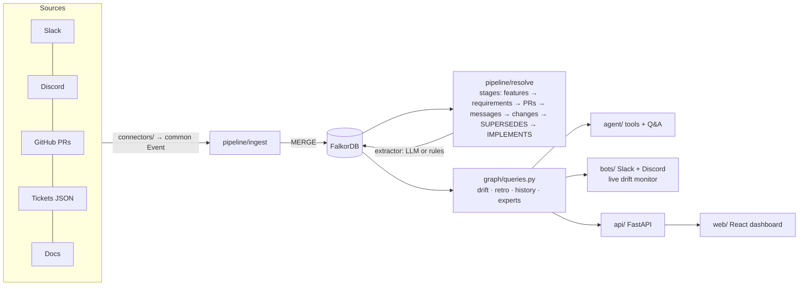
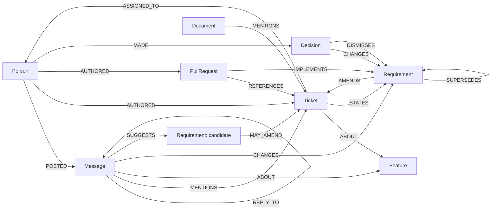

# Context Graph Drift Monitor

> **Graph Hacks: Context for AI Agents** (WeMakeDevs × FalkorDB). Track: **Company Brain**.

**TL;DR**
- **Problem:** decisions change in chat, tickets keep the old text, and PRs ship the old version.
- **How:** a FalkorDB context graph links chat, tickets, PRs and docs to the same requirement. Drift is a time-ordered path query: a requirement that nothing `SUPERSEDES` and no PR `IMPLEMENTS`.
- **Headline, all measured:**
  - Remove version reasoning and **half the drift alerts become false** (precision 1.00 → 0.50).
  - At **22,940 nodes** it finds **100 / 100** planted drifts.
  - With a small local LLM doing the extraction, 500 noise messages produce **1** noise-caused false alert, and both real drifts are found.
  - What the graph does **not** do: given the same extracted facts and version chain, a plain SQL join finds exactly the same drift (details under [Graph vs. a relational baseline](#2-graph-vs-a-relational-baseline)).


<sub>Frames captured from the running app by stepping through [`scripts/demo_script.md`](scripts/demo_script.md); not a screen recording. The GIF predates the latest dashboard restyle (section colours and headers), so the sections below the hero look plainer in it than in the app.</sub>

What one drift alert looks like. The graph path is the evidence:

```
(Person maya)-[:POSTED]->(Message @ slack#support-escalations, 2026-09-22)
   -[:CHANGES]->(Requirement "export supports any range up to 12 months + custom fields")
   -[:AMENDS]->(Ticket BD-101)-[:ABOUT]->(Feature "Ticket CSV export")
(PullRequest #6)-[:REFERENCES]->(Ticket BD-101), merged after the decision but IMPLEMENTS the older "last 30 days as CSV"
→ BD-101 still says "last 30 days"; PR #6 shipped the old scope; the export PRD is stale.
```

## Known weaknesses

Read these before the numbers. Each one is measured in [Results](#results).

- **Extraction on real text is the weak link.**
  - On two public GitHub repos, the rules extractor's drift flags were all false (0 of 25 labelled), and it found 1 of 7 real decisions in a 60-comment sample.
  - A small local LLM (qwen3:8b) still flags only 3 of those 25, but finds no more real decisions (also 1 of 7).
- **The labels are not independently verified.** The AI assistant labelled the real-data items. **0 of 25 have been re-checked by me** so far.
- **The graph itself is not the source of the accuracy.** Given the same extracted facts and the same version chain, an SQLite anti-join finds exactly the same drift, and its query runs in 0.7 ms against the graph's 41 ms at 20k messages (though the Cypher query also gathers the evidence). What the graph adds is listed under [Graph vs. a relational baseline](#2-graph-vs-a-relational-baseline).
- **A small LLM can't drive the graph tools.** In LLM-agent mode, qwen3:8b calls tools with invented ids and gives up. It scores 0.36 on the demo Q&A, against 0.84 for plain retrieval feeding the same model. The rules agent scores 1.00, but I tuned its routing after seeing which of those questions failed.
- **Rules under noise trade misses for floods.**
  - With rules, the fix that stops a misread message burying a real decision recovers both drifts, but raises 14 noise-caused false alerts.
  - The "unverified candidate" rule kept 14 noise messages and no real decision.
- **The strong-LLM path is unmeasured.** No hosted model was run: the DeepSeek key has no balance (`402`), and no other key is configured.
- **The demo company is synthetic** (300 messages, 15 tickets, 12 PRs), and I wrote the rules while looking at it. The synthetic 1.00s are an upper bound.
- **No real Slack workspace has been run yet** (see [Run on a real Slack workspace](#run-on-a-real-slack-workspace)).

## What it does

1. **Live drift alerts.** When a chat message changes a requirement that the ticket and PRs don't reflect, the bot replies in Slack or Discord with the graph path as evidence. The reply names the PRs that shipped the old version and the docs that still describe it. One rule ([`graph/queries.py`](graph/queries.py) `classify_prs`) labels each PR on the drifted ticket, and the card, evidence chain, Q&A answer, Slack alert and retro all use it:
   - merged **before** the decision → stale, "shipped the old version";
   - merged **after** it but `IMPLEMENTS` the older requirement → stale, "shipped the old version after the decision";
   - merged after it with no `IMPLEMENTS` link either way → **not** stale, shown separately as "unmatched, may implement the new scope".
2. **Sprint retro.** Shows what was decided, what shipped and where the two diverge, with a source on every line.
3. **Cited Q&A.** An agent answers from 9 graph tools and shows the graph paths it used. Without an LLM, a rules agent ([`agent/router.py`](agent/router.py)) answers from the same tools. It scores every intent and fails loudly when it can't resolve the feature, person or ticket.

**Human actions survive rebuilds.** "Keep old scope" and "Write to ticket" are stored as human-made nodes and re-attached by stable id after every rebuild ([`pipeline/human.py`](pipeline/human.py)). Everything else lives in [`docs/EXTRAS.md`](docs/EXTRAS.md).

## Why the graph

Drift is a **time-ordered path query**. A requirement from chat is drift when:
- nothing newer **SUPERSEDES** it;
- no PR **IMPLEMENTS** it;
- nobody chose to keep the old scope (**DISMISSES**).

```cypher
MATCH (m:Message)-[:CHANGES]->(r:Requirement)-[:AMENDS]->(t:Ticket)-[:ABOUT]->(f:Feature)
WHERE NOT (r)<-[:SUPERSEDES]-(:Requirement)          // still the newest requirement for this ticket
  AND NOT (:PullRequest)-[:IMPLEMENTS]->(r)          // and nothing shipped it
  AND NOT (:Decision)-[:DISMISSES]->(r)              // and nobody chose to keep the old scope
```

**IMPLEMENTS has a fallback**, so a missed extractor judgment doesn't become a false alert. When the extractor makes no IMPLEMENTS judgment, a PR on the same ticket that was **merged after** the change, states every number the change states, and is textually close to it counts as implementing it (`via: 'time+semantic'`). A PR merged before the change can't implement it ([`tests/test_implements_fallback.py`](tests/test_implements_fallback.py)).

### Ablation: switch the graph off, piece by piece

`python -m benchmark.ablation` → [`benchmark/results/ablation.json`](benchmark/results/ablation.json). Rules extractor, deterministic, no LLM. CI fails if the full graph drops below drift P/R 1.00, or if removing version reasoning stops making drift worse.

| Configuration | Msg→feature P / R | Changes P / R | Drift (requirement) P / R | Stale PRs P / R |
|---|---|---|---|---|
| **Full graph** | 1.00 / 0.92 | 1.00 / 1.00 | **1.00 / 1.00** | **1.00 / 1.00** |
| − thread structure (`REPLY_TO`) | 1.00 / **0.77** | 1.00 / 1.00 | 1.00 / 1.00 | 1.00 / 1.00 |
| − person/time proximity for PRs | 1.00 / 0.92 | 1.00 / 1.00 | 1.00 / 1.00 | 1.00 / 1.00 |
| − version reasoning (`SUPERSEDES` / `IMPLEMENTS`) | 1.00 / 0.92 | 1.00 / 1.00 | **0.50** / 1.00 | **0.67** / 1.00 |
| − time-aware IMPLEMENTS fallback | 1.00 / 0.92 | 1.00 / 1.00 | 1.00 / 1.00 | 1.00 / 1.00 |
| Ticket IDs only (no threads, proximity or semantic) | 1.00 / **0.33** | 1.00 / **0.50** | 1.00 / **0.00** | 1.00 / **0.00** |

- **Without version reasoning, half the alerts are false.** Two changes were written back into their tickets, but nothing knows the tickets caught up.
- **With ticket IDs only, both real drifts are missed.** The deciding messages never name a ticket.
- **Person/time proximity and the IMPLEMENTS fallback make no difference here.** The demo never has a PR that implements a chat decision directly. The fallback matters where that happens: in the test above, and in the qwen3 build below, where it removes qwen3's one false drift.

## Results

Every number comes from the command shown with it. Raw output is in [`benchmark/results/`](benchmark/results/).
- **Rules** = the rule-based extractor, no LLM.
- **qwen3:8b** = the LLM extractor running a local model through Ollama ([setup](#setup)).

No hosted model (DeepSeek, Groq, …) was run. Nothing below mixes extractors in one number.

### 1. Synthetic company: resolution and drift

`python -m pipeline.build --extractor heuristic && python -m benchmark.score_resolution` (rules) and `python -m pipeline.build --extractor llm --graph llm_demo && python -m benchmark.score_resolution --graph llm_demo` (qwen3:8b, [result](benchmark/results/resolution_llm_qwen3-8b.json)).

| Metric (P / R) | Rules | qwen3:8b |
|---|---|---|
| ticket → feature | 1.00 / 1.00 | 0.60 / 1.00 |
| message → feature | 1.00 / 0.92 | 0.59 / **1.00** |
| PR → ticket (incl. PR #7 with no ticket id) | 1.00 / 1.00 | 1.00 / 1.00 |
| requirement changes from chat | 1.00 / 1.00 | 0.67 / 1.00 |
| drift (ticket) | 1.00 / 1.00 | 1.00 / 1.00 |
| drift (requirement) | 1.00 / 1.00 | 1.00 / 1.00 |
| stale PRs / stale docs | 1.00 / 1.00 | 1.00 / 1.00 |

- **The rules score 1.00 because I wrote them while looking at this data.** Treat that as an upper bound.
- **qwen3 finds the paraphrased SLA thread the rules miss** (message → feature R = 1.00).
- **qwen3 groups one-off tickets into 5 extra features**, so the feature-link precision drops.
- **qwen3 makes no IMPLEMENTS judgment of its own.** It reads a "columns" remark (m_exp_07) as a change. The time-aware fallback then links PR #6, which ships those columns, to it. Without the fallback this was a false drift (requirement-level P was 0.67 before).

### 2. Graph vs. a relational baseline

`python -m benchmark.sql_baseline` → [`sql_baseline.json`](benchmark/results/sql_baseline.json). `resolve()` runs once. Its plain-data output goes into an in-memory SQLite database:
- requirements, chat changes and PR → ticket links;
- IMPLEMENTS judgments;
- the supersession pairs computed in Python.

The SQL side never reads the graph. Two SQL variants:
- **`sql_chain`:** drift as an anti-join over the same supersession pairs.
- **`sql_latest`:** no version chain; the "current" requirement is simply the newest per ticket (`ROW_NUMBER()`).

| Dataset | Graph drift found (true / false) | `sql_chain` | `sql_latest` | p50 drift query: graph / `sql_chain` |
|---|---|---|---|---|
| Demo (300 messages) | 2 / 0 | **identical** | identical | 2.8 ms / 0.01 ms |
| Demo + 500 noise messages | 2 / 14 | **identical** | 0 / 5, **misses both** | 5.4 ms / 0.02 ms |
| Stress test (20,800 messages) | 100 / 0 | **identical** | identical | 41 ms / 0.7 ms |

`sql_chain` also returns the same stale PRs and the same current requirement per ticket on all three datasets.

Lines of query code: Cypher `DRIFT` has 24, against 6 for `sql_chain` and 8 for `sql_latest`. The Cypher query also gathers the evidence (author, previous version, stale PRs, docs), and it runs over the network to FalkorDB, so neither comparison is like-for-like.

**What this means:**
- **Drift detection is a join.** The value is in the version-chain reasoning (`supersession_pairs`, `reflects`), which is application logic, not something only a graph database can do.
- **Without that chain, a relational query falls into the old "latest message wins" trap** under noise.
- **What the graph still gives** (none of this is measured as a speedup here):
  - variable-depth connection questions ("how is liam connected to PR #6?") via `algo.SPpaths`, where SQL needs recursive CTEs;
  - the evidence path returned with every answer;
  - adding a new node or edge type without a schema migration.

### 3. Q&A: graph vs. retrieval

**At scale:** `python -m benchmark.qa_scale` → [`qa_scale.json`](benchmark/results/qa_scale.json). The stress-test org (200 features, 20,800 messages), rules agent vs. top-k TF-IDF passages returned verbatim, questions generated from ground truth (seed 0).

| | Per-feature (n = 18) | Cross-feature (**n = 3**, F1 over ids named) |
|---|---|---|
| graph (rules agent) | 1.00 · 18/18 | 1.00 · 3/3 |
| retrieval top-25 | 1.00 · 18/18 | 0.15 · 0/3 |
| retrieval top-100 | 1.00 · 18/18 | 0.40 · 1/3 |

- **Per-feature questions are a tie.** Retrieval doesn't degrade at 20k messages here: topic words are unique and the noise is generic.
- **The cross-feature win is n = 3, and partly by construction.** Each answer is 100 ids spread over 200 features, which top-k retrieval can't return, so this mostly shows the limit of top-k, not graph intelligence. A relational query answers these too (section 2).
- **Top-100's 1.00 on "which tickets are stale" is an artifact:** drifted tickets have shorter passages.
- **The router was tuned after seeing these questions.** The third question was a routing miss before the router fix, so this agent result is not held-out.

**Demo Q&A** (15 questions, 300 messages): `python -m benchmark.run --no-llm` → [`latest.json`](benchmark/results/latest.json) and `python -m benchmark.run` with qwen3:8b configured → [`latest_llm_qwen3-8b.json`](benchmark/results/latest_llm_qwen3-8b.json).

| System | Mean score | Fully correct |
|---|---|---|
| graph, rules agent (no LLM) | 1.00 | 15/15 |
| retrieval top-3, extractive (no LLM) | 0.60 | 6/15 |
| retrieval top-25, extractive (no LLM) | 0.98 | 14/15 |
| graph, **LLM agent (qwen3:8b)** | **0.36** | 5/15 |
| retrieval top-25 → **qwen3:8b** | **0.84** | 11/15 |

- **The rules agent's 15/15 is after fixing q03's routing.** I fixed it knowing q03 had failed, so it's no longer a held-out result.
- **The qwen3 agent fails at tool use, not at the data.** It typically makes one call with an invented id (`BD-123`) or a feature name instead of an id, gets nothing back, and answers "I don't know".
- **Retrieval into the same model needs no tool calls, so a small model does better there.**

### 4. Real data: extraction on text I didn't write

[`benchmark/real_data.py`](benchmark/real_data.py) maps a public repo's issues to tickets, comments to chat and PRs to PRs, then runs the same pipeline. Snapshots are in [`data/real/`](data/real/). Labels are in [`real_data_labels.json`](benchmark/real_data_labels.json) and [`real_data_recall_labels.json`](benchmark/real_data_recall_labels.json).

**Labelled by the AI assistant, not re-checked by me: 0 of 25 precision items and 0 of 60 recall items re-checked.** Please spot-check the URLs.

**Precision sets.** The rules flagged 5 drifts on [FalkorDB/FalkorDB](https://github.com/FalkorDB/FalkorDB), and 2 with the current pipeline. Excalidraw gave 0. I also labelled 20 of the 91 "decision" classifications among 1,575 comments, sampled at random.

**Recall sets,** labelled before running any extractor:
- 30 random issue comments: **0** real decisions;
- 30 comments from recently accepted [golang/go proposals](https://github.com/golang/go/issues?q=label%3AProposal-Accepted): **7** real decisions. This pool is enriched on purpose.

`python -m benchmark.real_data extraction --extractor heuristic|llm`:

| | Rules | qwen3:8b |
|---|---|---|
| The 25 known false positives: still called a change | 25 / 25 | **3 / 25** |
| 60-comment sample: precision | 0.17 (1 of 6 flagged) | 0.25 (1 of 4 flagged) |
| 60-comment sample: recall | 0.14 (1 of 7) | 0.14 (1 of 7) |

- **The rules fail** on code review and status (12 of 25), analysis that *asks* for a decision (6) and volunteer proposals (5).
- **qwen3:8b mostly avoids those mistakes**, and the evidence guard discarded 2 of its extractions.
- **Both miss the Go decisions,** which say "accepted" and "the proposal is to…".
- **The qwen3 prompt names these failure patterns,** so its real-data numbers aren't fully independent.

### 5. Noise: 500 messages that change nothing

`python -m benchmark.noise [--extractor llm]` → [`noise.json`](benchmark/results/noise.json), [`noise_llm_qwen3-8b.json`](benchmark/results/noise_llm_qwen3-8b.json). The demo plus 500 injected messages (seed 0):
- 250 real GitHub comments;
- 250 on-topic messages that change nothing (status, review, proposals, questions, customer requests). I wrote these from the real-data failure patterns, so they're deliberately adversarial.

Each configuration adds one change to the previous one. Alerts are split into real drifts found (of 2), alerts caused by noise, and other false alerts from the scenario itself.

| Configuration | Rules: noise read as changes | Rules: alerts (real · noise · other) | qwen3:8b: noise read as changes | qwen3:8b: alerts (real · noise · other) |
|---|---|---|---|---|
| **1. Original:** the latest chat change wins | 59 | 7 (0 · 7 · 0) | 4 | 4 (1 · 0 · 3) |
| **2. + decision rights:** only the ticket's creator or assignee can change it | 17 | 5 (0 · 5 · 0) | 3 | 4 (2 · 1 · 1) |
| **3. + no burial:** chat replaces chat only when judged to | 17 | 16 (**2** · 14 · 0) | 3 | 4 (**2** · 1 · 1) |
| **4. + unverified candidates** (current default) | 17 | 16 (2 · 14 · 0) | 3 | 4 (2 · 1 · 1) |

- **Decision rights alone recovers no drift with rules.** It's a negative result on its own.
- **"No burial" brings both real drifts back with rules,** at the cost of 14 noise-caused alerts.
- **With qwen3:8b, the noise mostly doesn't get through extraction**, so the same pipeline ends with 2 real alerts, 1 from noise and 1 scenario false positive.
- **Unverified candidates:** a change by a non-owner on a *guessed* ticket is kept as `status: 'candidate'` (shown on the dashboard, never drift) instead of dropped.
  - With rules: 14 candidates, all from noise, none from the scenario. No benefit measured on this data.
  - With qwen3: 0 candidates.
- **The rules row moved since the earlier draft.** It used to read 6 → 17 false alerts; it's now 5 → 14 because of the IMPLEMENTS fallback, which links some noise "changes" to PRs merged after them.

**MIN_CONFIDENCE sensitivity**, on configuration 4:

| `MIN_CONFIDENCE` | Rules: alerts (real · noise) | qwen3:8b: alerts (real · noise) |
|---|---|---|
| 0.4 | 16 (2 · 14) | 4 (2 · 1) |
| 0.6 (default) | 16 (2 · 14) | 4 (2 · 1) |
| 0.8 | **0 (0 · 0)** | 4 (2 · 1) |

The rules give every change confidence 0.7, so they pass everything up to 0.7 and nothing at 0.8. qwen3's confidences are all at least 0.8. This threshold doesn't separate signal from noise for either extractor on this data.

### 6. Stress test

`python -m benchmark.scale` → [`scale_200x20000.json`](benchmark/results/scale_200x20000.json). 200 features, 600 tickets, 200 PRs, 20,800 messages, 100 planted drifts. Local Docker FalkorDB on a laptop:

| Stage | Result |
|---|---|
| Graph size | 22,940 nodes · 27,700 relationships |
| Ingest / resolution | 2.2 s / 3.1 s |
| Drift detection | 100 / 100 found, 0 false positives |
| Drift query: whole graph / one ticket | p50 39 ms / 2.4 ms |
| Connection query (`algo.SPpaths`) | p50 6.1 ms |
| Live monitor, one incoming message | p50 38 ms |

The generator writes clean decision messages, so this measures the graph and the queries at size, not extraction. Resolution and the live path are slower than in the earlier draft (2.0 s, 20 ms): the live monitor now rebuilds the ticket's whole version chain, and resolution runs the IMPLEMENTS fallback.

Problems the stress test caught, each covered by a test or a CI check:
- silent truncation at 10k rows (paged reads);
- a path query that timed out (`algo.SPpaths`);
- label scans (CI fails on any);
- a dense TF-IDF scan (inverted index).

How these work: [`docs/EXPLAIN.md`](docs/EXPLAIN.md).

## Run on a real Slack workspace

> **TODO: not run yet.** Everything to do it is in [`docs/REAL_RUN.md`](docs/REAL_RUN.md):
> - the app, scopes and tokens;
> - `check_setup`, which names any missing scope;
> - seeding, `build --live` (Slack only is enough);
> - triggering a live alert.
>
> The screenshots of a real thread with the bot's reply will go here. Until then, the connectors are only tested against fake Slack, Discord and GitHub APIs ([`tests/test_connectors.py`](tests/test_connectors.py)).

## Architecture



| Folder | What's in it |
|---|---|
| [`connectors/`](connectors/) | Slack, Discord, GitHub, mock-ticket and docs connectors, plus a scenario replay. All emit one `Event` format |
| [`pipeline/`](pipeline/) | `ingest`, `extract` (LLM / rules / oracle), `resolve` (one function per stage), `human` (actions that survive rebuilds), `live`, `webhooks` |
| [`graph/`](graph/) | Connection, idempotent batched writers, [`queries.py`](graph/queries.py) with every Cypher query ([reference](docs/QUERIES.md)) |
| [`agent/`](agent/) | Graph tools, LLM agent and rules agent, retro, spec generator |
| [`bots/`](bots/) | Slack (Socket Mode) and Discord bots, daily digest |
| [`api/`](api/), [`web/`](web/) | FastAPI backend and React + TypeScript dashboard |
| [`benchmark/`](benchmark/) | Every measurement in [Results](#results), including the SQL baseline |
| [`config.py`](config.py) | Every tuning constant, with the reason for its value |

<details>
<summary>Graph data model, resolution and extractors</summary>



- **Idempotent writes.** Every node is MERGEd on `id`.
- **Integer times.** Times are epoch-ms integers.
- **One node per ticket version.** Each ticket version is its own `Requirement`.
- **Explainable links.** Every resolution edge records `via`.
- **Human actions** carry `origin: 'human'`. Only extractor-made decisions are deleted on rebuild.

**Requirement changes** come from messages by someone with **decision rights** (the ticket's creator or assignee), at confidence ≥ `MIN_CONFIDENCE`. **The LLM extractor** returns structured output with an `evidence_quote`, which must appear literally in the message or the extraction is discarded.

**Extractors** (`--extractor`):
- `auto`: `llm` if the LLM answers, otherwise `heuristic`.
- `llm` (alias `deepseek`): any OpenAI-compatible model.
- `heuristic`: the rules.
- `oracle`: the answer key; a test harness only.

</details>

### The synthetic company

**Brightdesk** ([`data/scenario/company.md`](data/scenario/company.md)) is a helpdesk SaaS with 8 people, 2 sprints, 300 messages, 15 tickets, 12 PRs and 4 docs.
- **Two drifts:** the CSV export (Slack) and the SLA notifications (Discord).
- **One clean control:** dark mode.
- **Traps:**
  - a change copied into its ticket;
  - a rejected XLSX proposal;
  - a "keep it as is" reaffirmation;
  - a PR with no ticket reference;
  - a decision on Discord about work tracked elsewhere.

[`answer_key.json`](data/scenario/answer_key.json) records every expected link, change and drift.

## Setup

Requires Python 3.11+, Docker (local FalkorDB) or FalkorDB Cloud, and Node 18+ for the dashboard.

```bash
python -m venv .venv
.venv\Scripts\activate             # macOS/Linux: source .venv/bin/activate
pip install -r requirements.txt
cp .env.example .env               # every service is optional except FalkorDB
docker run -d --name falkordb-brain -p 6379:6379 -p 3001:3000 falkordb/falkordb:v4.22.1
python -m scripts.check_setup      # PASS/FAIL per service; for Slack it names any missing scope

python -m pipeline.build           # ingest + extraction + resolution, prints drift
cd web && npm install && npm run build && cd ..
uvicorn api.main:app --port 8000   # dashboard + API on http://localhost:8000
python -m scripts.demo_reset       # put the demo back in its starting state (see scripts/demo_script.md)
```

**The LLM is optional, and it can be local.** Any OpenAI-compatible endpoint works. For a free, offline, reproducible run with [Ollama](https://ollama.com), set these in `.env`:

```bash
ollama pull qwen3:8b
LLM_BASE_URL=http://localhost:11434/v1
LLM_MODEL=qwen3:8b
LLM_API_KEY=ollama
LLM_REASONING_EFFORT=none   # skip qwen3's thinking phase, about 15x faster
```

Unset, it uses DeepSeek (`DEEPSEEK_*`). Every call is cached by (model, prompt) in `data/llm_cache/`, which is committed, so the qwen3 numbers reproduce without a GPU. When no LLM answers, everything falls back instead of failing.

**Real Slack, Discord and GitHub:** see [`docs/REAL_RUN.md`](docs/REAL_RUN.md). `build --live` reads each configured source from its API, falls back to the scenario files for the rest, and prints which is which.

### Tests and CI

`python -m pytest -q` runs 91 tests, none of which need an LLM or API keys. They include:
- human actions surviving rebuilds;
- the IMPLEMENTS fallback;
- one stale-PR rule everywhere: for BD-103 / PR #5 and BD-101 / PR #6, the card's count, the PR label, the evidence path and the Q&A answer agree ([`tests/test_stale_pr_consistency.py`](tests/test_stale_pr_consistency.py));
- unverified candidates;
- routing per intent and the former misroutes;
- the SQL baseline and the ablation guard;
- the graph, API, webhooks, connector contracts and paging.

[`.github/workflows/ci.yml`](.github/workflows/ci.yml) also runs:
- ruff (lint and format) and mypy on `pipeline/` and `graph/`;
- the ablation, which fails on regression;
- the query-plan index check and a small stress test;
- the `docs/QUERIES.md` check and the React build.

FalkorDB is pinned to `v4.22.1`.

## Limitations

- **Real-text extraction is the open problem** (Results 4 and 5). The strong hosted LLM run is the missing measurement.
- **The labels are the AI assistant's and are unverified** (0 of 25 re-checked by me). The recall sample has only 7 positives.
- **The graph's advantage is not accuracy.** Given the same facts and chain, SQL matches it (Result 2).
- **Small-model agents fail at tool calling.** Use the rules agent, or retrieval, with qwen3:8b-class models.
- **No burial means more alerts with rules.** Misread messages surface as alerts instead of hiding real drift.
- **Decision rights is coarse.** Unverified candidates keep non-owner changes visible, but here they only caught noise.
- **The Q&A grader is keyword-based, and the router was tuned on the benchmark questions.** Cross-feature questions use F1 over named ids, which is stricter.
- **Same-ticket scope.** A PR on a sibling ticket isn't flagged as stale.
- **Single-version issues.** Each GitHub issue is one version in the real-data run.

## What changed since the first submission draft

- **Dismissals and write-backs now survive a rebuild.** They were deleted by every `resolve()` and every full build.
- **A missed IMPLEMENTS judgment no longer means a false drift.** There's a time-aware fallback, and PRs are labelled as merged before or after the decision.
- **New SQL baseline.** It matches the graph on drift given the same chain, so the headline no longer rests on the 3-question retrieval comparison.
- **The rules router scores intents, fails loudly, and sends PR ids to a PR lookup.** The q03 and stress-test misroutes are fixed (and disclosed as tuned).
- **`resolve()` is split into stages.** Outputs are byte-identical on every benchmark; constants and weights live in `config.py`.
- **qwen3:8b measured on the noise set and in LLM-agent Q&A.** The agent result is negative and reported as such.
- **Real Slack run prepared but not done:** scope-aware `check_setup`, per-source `--live`, `docs/REAL_RUN.md`.
- **Hygiene:** MIT license, pinned FalkorDB, ruff and mypy in CI, and an ablation that fails CI on regression.
- **One stale-PR rule across the product.** The Q&A answer used to say "PRs that shipped the old version: none" while its own evidence path showed PR #5 implementing the older requirement. PRs merged after the decision that implement the old version are now stale everywhere; only PRs with no link either way are "unmatched".
- **"Days open" no longer grows with the real clock.** On the synthetic company it counts from a fixed reference date in [`data/scenario/config.json`](data/scenario/config.json) (2026-10-10, the morning after the last message); live builds use today.
- **Dashboard.** Q&A drift answers list one fact per line, with the graph paths behind a toggle; drift cards dropped duplicated text; sections after the hero have their own colour, numbered headers and lit panels. Rules-agent Q&A is unchanged at 15/15.

## AI assistant disclosure

This project was built with help from an AI coding assistant (Claude Code), as the hackathon rules allow. The idea, the scenario and the graph model come from my project plan, and I can explain each part of the code, queries and architecture ([`docs/EXPLAIN.md`](docs/EXPLAIN.md)). The real-data labels were made by the assistant and are marked as such.
