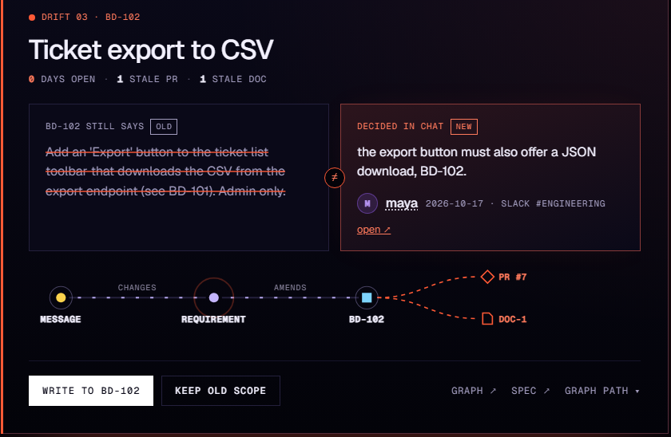
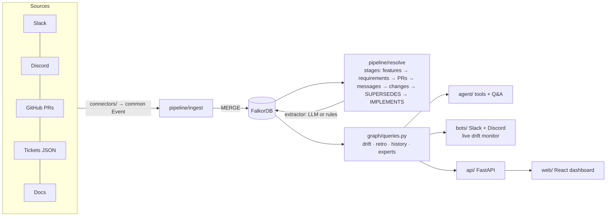
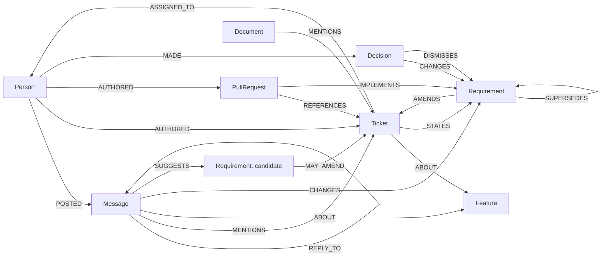

# Context Graph Drift Monitor

> **Graph Hacks: Context for AI Agents** (WeMakeDevs × FalkorDB). Track: **Company Brain**.

**Decisions change in chat. Tickets keep the old text, and PRs ship the old version.** This project keeps a FalkorDB context graph of a team's Slack, Discord, tickets, GitHub PRs and docs, and catches the moment they disagree. When someone with the right to change a ticket decides something new in chat, and nothing newer replaces it and no PR ships it, the bot replies **in the thread** with the graph path as evidence.


<sub>Frames captured from the running app by stepping through [`scripts/demo_script.md`](scripts/demo_script.md); not a screen recording. It predates the latest dashboard restyle.</sub>

**It ran in a real Slack workspace.** A ticket owner's message got this in-thread alert within seconds ([details](#proof-it-runs)):


What one alert means. The graph path is the evidence:

```
(Person maya)-[:POSTED]->(Message @ slack#support-escalations, 2026-09-22)
   -[:CHANGES]->(Requirement "export supports any range up to 12 months + custom fields")
   -[:AMENDS]->(Ticket BD-101)-[:ABOUT]->(Feature "Ticket CSV export")
(PullRequest #6)-[:REFERENCES]->(Ticket BD-101), merged after the decision but IMPLEMENTS the older "last 30 days as CSV"
→ BD-101 still says "last 30 days"; PR #6 shipped the old scope; the export PRD is stale.
```

## What the company brain answers

One graph, built from chat, tickets, PRs and docs, answers the questions a team actually asks:

| Question | How | Where |
|---|---|---|
| **Did we ship what we decided?** | Drift: a chat requirement that nothing `SUPERSEDES`, no PR `IMPLEMENTS`, and nobody `DISMISSES` | Slack / Discord alert in the thread, dashboard card, Q&A |
| **Who decided this, where, and what did it replace?** | The decision's `Message`, its author and channel, and the version chain it amends | every alert and card, `decision_history` |
| **Who owns this, and who knows the most about it?** | Ticket owners, plus people ranked by decisions > PRs > tickets > messages on a feature | `who_knows`, person profiles, Q&A ("Who knows the most about ticket export?") |
| **Where is knowledge held by one person?** | Share of a feature's involvement held by its top person (bus factor) | Coverage & risk |
| **How are these two connected?** | Shortest causal path between any two things (`algo.SPpaths`), e.g. a support agent and a PR | Q&A ("How is liam connected to PR #6?") |
| **What did this sprint decide, ship, and leave diverged?** | Decisions, merged PRs and drift per sprint, each with its source | Sprint retro |
| **What has no paper trail?** | PRs with no ticket, closed tickets with no PR, tickets nobody ever discussed | Coverage & risk |
| **What should the next agent build?** | The current requirement per ticket with its evidence, as a spec | Agent-ready spec |

Two ways to fix a drift from the dashboard, both kept as human-made graph nodes that survive every rebuild: **Write to ticket** (the decision becomes the ticket's next version) or **Keep old scope** (a recorded dismissal).

The Q&A agent answers from 9 graph tools and shows the tool calls and graph paths it used. Without an LLM, a rules agent answers from the same tools; it says so when a named ticket or PR doesn't exist, and flags a weak match instead of answering about the wrong thing.

## Why it needs a graph

Drift is a **time-ordered path question**, not a lookup. A chat requirement is drift when nothing newer replaced it, no PR implements it, and nobody chose to keep the old scope:

```cypher
MATCH (m:Message)-[:CHANGES]->(r:Requirement)-[:AMENDS]->(t:Ticket)-[:ABOUT]->(f:Feature)
WHERE NOT (r)<-[:SUPERSEDES]-(:Requirement)          // still the newest requirement for this ticket
  AND NOT (:PullRequest)-[:IMPLEMENTS]->(r)          // and nothing shipped it
  AND NOT (:Decision)-[:DISMISSES]->(r)              // and nobody chose to keep the old scope
```

What the graph does in this project:
- **Versions as nodes.** Every ticket version and every chat change is its own `Requirement`, linked by `SUPERSEDES` over time. "Latest message wins" is the trap: under noise, a relational "newest row per ticket" query misses both real drifts ([Results §2](docs/RESULTS.md#2-graph-vs-a-relational-baseline)).
- **Evidence travels with the answer.** Every alert, card and Q&A answer returns the path that proves it: person → message → requirement → ticket → feature, plus the PRs and docs still on the old version.
- **Multi-hop questions.** "How is the support agent connected to PR #6?" is a variable-depth path (`algo.SPpaths`, p50 6.1 ms at 22,940 nodes).
- **Context links that ids miss.** The deciding messages never name a ticket. Threads (`REPLY_TO`), people and time connect them. With ticket ids only, both real drifts are missed; without thread structure, message→feature recall drops from 0.92 to 0.77.
- **Switch the version reasoning off and half the alerts become false** (precision 1.00 → 0.50, and no stale PR is found). The ablation runs in CI and fails the build on regression.
- **New sources without migrations.** Slack, Discord, GitHub, tickets and docs all become nodes and edges of one model; unverified candidates, alerts and human decisions were added later as new node types and properties, with no migration.

The honest boundary: given the same extracted facts and the same version chain, a SQL anti-join finds the same drift, faster. The graph's job here is the model, the evidence and the traversal, not a faster join ([Results §2](docs/RESULTS.md#2-graph-vs-a-relational-baseline)).

## Proof it runs

- **Real Slack, 2026-10-17.** I seeded the synthetic company's 156 Slack messages into a free workspace, built the graph from the Slack API (`slack: live API`), and posted a decision as the BD-102 owner. The bot replied in the thread within seconds; the dashboard showed the new card; a later rebuild from Slack history found the same change on its own. It also found a real bug (Slack code formatting kept in the stored text), now fixed and tested. Steps: [`docs/REAL_RUN.md`](docs/REAL_RUN.md).

  

- **At scale.** 22,940 nodes, 27,700 relationships, 20,800 messages: 100 of 100 planted drifts found, 0 false; drift query p50 39 ms for the whole graph, 2.4 ms for one ticket; one live message p50 38 ms.
- **Tested.** 109 tests (no LLM or API keys needed) and CI with ruff, mypy, the ablation gate, a query-plan index check and a stress test.

## Results at a glance

Every number comes from a command in [`docs/RESULTS.md`](docs/RESULTS.md), which has the full tables. Rules = the rule-based extractor; qwen3:8b = a small local LLM; gpt-oss-120b = OpenAI's open-weight 120B model on Groq's free tier.

| Measurement | Result |
|---|---|
| Synthetic company (300 messages): drift P / R | Rules **1.00 / 1.00**; qwen3:8b 1.00 / 1.00 |
| Ablation: remove version reasoning | drift precision 1.00 → **0.50**; stale PRs found 1.00 → 0.00 |
| 500 noise messages, rules / qwen3:8b | both real drifts found; 14 / **1** noise-caused false alerts |
| Stress test, 22,940 nodes | **100 / 100** planted drifts, 0 false |
| Real GitHub text, rules / qwen3:8b / gpt-oss-120b | known false positives still flagged: 25/25 / 3/25 / **2/25**; recall 1/7 / 1/7 / **2/7**, precision of what's flagged 0.17 / 0.25 / **1.00** |
| Demo Q&A (15 questions), **gpt-oss-120b agent over the graph** / retrieval into the same model | **0.84** (11/15) / 0.71 (8/15) |
| Demo Q&A, rules agent (no LLM) / raw top-25 passages | 0.86 / **0.98**; the passage dump wins, at five times the answer length |
| Cross-feature Q&A at 20k messages (n = 3) | rules agent 1.00 / retrieval top-25 0.15 |
| Same facts in SQL | **identical** drift |

## Known weaknesses

The full list, with numbers, is in [`docs/RESULTS.md`](docs/RESULTS.md#limitations).

- **Extraction on real text is the weak link.** On two public GitHub repos the rules' drift flags were all false (0 of 25 labelled). A strong model (gpt-oss-120b) fixes the false positives (2 of 25 still flagged, and everything it flagged in the sample was right) but still finds only 2 of 7 real decisions. The real-data labels were made by the AI assistant, and 0 of 25 have been re-checked by me.
- **The rules, prompts and thresholds were written against the test data.** The synthetic 1.00s are an upper bound: raising one similarity threshold from 0.22 to 0.30 halves drift recall.
- **The demo is small.** Two real drifts; the ablation's "half are false" is 2 of 4 alerts.
- **A small LLM can't drive the tools.** The qwen3:8b agent scores 0.33 on the demo Q&A. A strong model (gpt-oss-120b) scores 0.84 and beats retrieval into the same model, but only 15 questions were run, on the free tier.
- **The graph is not the source of the accuracy** (see above).
- **The real-Slack run used the synthetic company's messages,** in a one-person workspace; Discord and GitHub have not been run live.

## Architecture



| Folder | What's in it |
|---|---|
| [`connectors/`](connectors/) | Slack, Discord, GitHub, mock-ticket and docs connectors, plus a scenario replay. All emit one `Event` format |
| [`pipeline/`](pipeline/) | `ingest`, `extract` (LLM / rules / oracle), `resolve` (one function per stage), `human` (actions that survive rebuilds), `live`, `webhooks` |
| [`graph/`](graph/) | Connection, idempotent batched writers, [`queries.py`](graph/queries.py) with every Cypher query ([reference](docs/QUERIES.md)) |
| [`agent/`](agent/) | Graph tools, LLM agent and rules agent, retro, spec generator |
| [`bots/`](bots/) | Slack (Socket Mode) and Discord bots, daily digest |
| [`api/`](api/), [`web/`](web/) | FastAPI backend and React + TypeScript dashboard |
| [`benchmark/`](benchmark/) | Every measurement in [`docs/RESULTS.md`](docs/RESULTS.md), including the SQL baseline |
| [`config.py`](config.py) | Every tuning constant, with the reason for its value |

<details>
<summary>Graph data model, resolution and extractors</summary>



- **Idempotent writes.** Every node is MERGEd on `id`.
- **Integer times.** Times are epoch-ms integers.
- **One node per ticket version.** Each ticket version is its own `Requirement`.
- **Explainable links.** Every resolution edge records `via`.
- **Human actions** carry `origin: 'human'`. Only extractor-made decisions are deleted on rebuild.

**Requirement changes** come from messages by someone with **decision rights** (the ticket's creator or assignee), at confidence ≥ `MIN_CONFIDENCE`. **The LLM extractor** returns structured output with an `evidence_quote`, which must appear literally in the message or the extraction is discarded.

**Extractors** (`--extractor`):
- `auto`: `llm` if the LLM answers, otherwise `heuristic`.
- `llm` (alias `deepseek`): any OpenAI-compatible model.
- `heuristic`: the rules.
- `oracle`: the answer key; a test harness only.

</details>

### The synthetic company

**Brightdesk** ([`data/scenario/company.md`](data/scenario/company.md)) is a helpdesk SaaS with 8 people, 2 sprints, 300 messages, 15 tickets, 12 PRs and 4 docs.
- **Two drifts:** the CSV export (Slack) and the SLA notifications (Discord).
- **One clean control:** dark mode.
- **Traps:**
  - a change copied into its ticket;
  - a rejected XLSX proposal;
  - a "keep it as is" reaffirmation;
  - a PR with no ticket reference;
  - a decision on Discord about work tracked elsewhere.

[`answer_key.json`](data/scenario/answer_key.json) records every expected link, change and drift.

## Setup

Requires Python 3.11+, Docker (local FalkorDB) or FalkorDB Cloud, and Node 18+ for the dashboard.

```bash
python -m venv .venv
.venv\Scripts\activate             # macOS/Linux: source .venv/bin/activate
pip install -r requirements.txt
cp .env.example .env               # every service is optional except FalkorDB
docker run -d --name falkordb-brain -p 6379:6379 -p 3001:3000 falkordb/falkordb:v4.22.1
python -m scripts.check_setup      # PASS/FAIL per service; for Slack it names any missing scope

python -m pipeline.build           # ingest + extraction + resolution, prints drift
cd web && npm install && npm run build && cd ..
uvicorn api.main:app --port 8000   # dashboard + API on http://localhost:8000
python -m scripts.demo_reset       # put the demo back in its starting state (see scripts/demo_script.md)
```

**The LLM is optional, and it can be local.** Any OpenAI-compatible endpoint works. For a free, offline, reproducible run with [Ollama](https://ollama.com), set these in `.env`:

```bash
ollama pull qwen3:8b
LLM_BASE_URL=http://localhost:11434/v1
LLM_MODEL=qwen3:8b
LLM_API_KEY=ollama
LLM_REASONING_EFFORT=none   # skip qwen3's thinking phase, about 15x faster
```

The strong-model numbers used Groq's free tier:

```bash
LLM_BASE_URL=https://api.groq.com/openai/v1
LLM_MODEL=openai/gpt-oss-120b
LLM_API_KEY=gsk_...
LLM_REASONING_EFFORT=low
LLM_MAX_RETRIES=10          # the free tier allows 8,000 tokens a minute
```

Unset, it uses DeepSeek (`DEEPSEEK_*`). Every extraction call is cached by (model, prompt) in `data/llm_cache/`, which is committed, so the qwen3 and gpt-oss **extraction** numbers (resolution, noise, real data) reproduce without a GPU or key. The **Q&A** numbers don't: the agent's calls aren't cached, so re-running them needs the model (Ollama or a key). When no LLM answers, everything falls back instead of failing.

**Real Slack, Discord and GitHub:** see [`docs/REAL_RUN.md`](docs/REAL_RUN.md). `build --live` reads each configured source from its API, falls back to the scenario files for the rest, and prints which is which.

### Tests and CI

`python -m pytest -q` runs 109 tests, none of which need an LLM or API keys. They include:
- the published numbers in [`docs/RESULTS.md`](docs/RESULTS.md) against the committed result files ([`tests/test_readme_numbers.py`](tests/test_readme_numbers.py));
- human actions surviving rebuilds, and live updates (a write-back survives a live recompute; an unverified candidate never supersedes the owner's decision);
- auth on every endpoint that changes the graph, GitHub webhook signatures and replayed deliveries, and per-org event isolation;
- router paraphrases outside the benchmark: unknown ids, loose PR ids, ticket-scoped answers;
- the IMPLEMENTS fallback;
- one stale-PR rule everywhere: for BD-103 / PR #5 and BD-101 / PR #6, the card's count, the PR label, the evidence path and the Q&A answer agree ([`tests/test_stale_pr_consistency.py`](tests/test_stale_pr_consistency.py));
- unverified candidates;
- routing per intent and the former misroutes;
- the SQL baseline and the ablation guard;
- the graph, API, webhooks, connector contracts and paging.

[`.github/workflows/ci.yml`](.github/workflows/ci.yml) also runs:
- ruff (lint and format) and mypy on `pipeline/` and `graph/`;
- the ablation, which fails on regression;
- the query-plan index check and a small stress test;
- the `docs/QUERIES.md` check and the React build.

FalkorDB is pinned to `v4.22.1`.

The full change history since the first submission draft is in [`docs/RESULTS.md`](docs/RESULTS.md#what-changed-since-the-first-submission-draft).

## AI assistant disclosure

This project was built with help from an AI coding assistant (Claude Code), as the hackathon rules allow. The idea, the scenario and the graph model come from my project plan, and I can explain each part of the code, queries and architecture ([`docs/EXPLAIN.md`](docs/EXPLAIN.md)). The real-data labels were made by the assistant and are marked as such.
