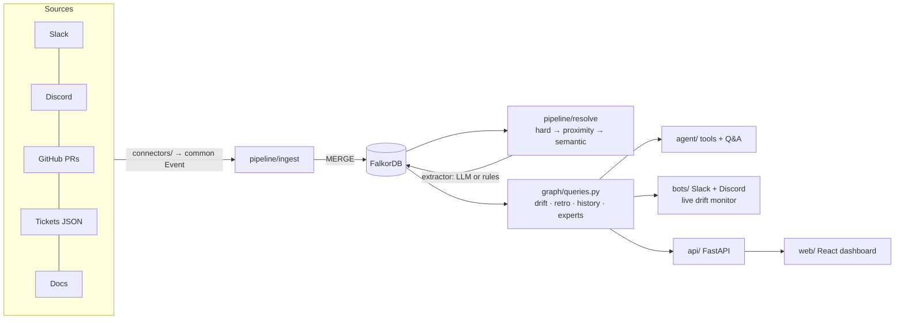
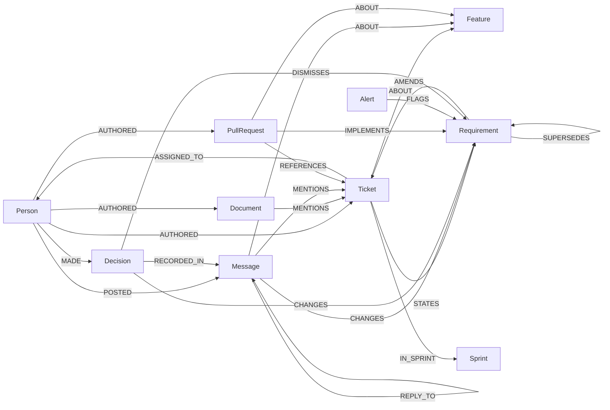

# Context Graph Drift Monitor

> **Graph Hacks: Context for AI Agents** (WeMakeDevs × FalkorDB). Track: **Company Brain**.

**TL;DR**
- **Problem:** decisions change in chat, tickets keep the old text, and PRs ship the old version.
- **Why a graph:** "has this decision reached the ticket and the code?" is a time-ordered path question: a requirement that nothing `SUPERSEDES` and no PR `IMPLEMENTS`.
- **Headline:**
  - Switch off the graph's version edges and **half the drift alerts become false** (precision 1.00 → 0.50).
  - At **22,940 nodes**, it still finds **100 / 100** planted drifts.
  - On questions that span features, the graph scores **0.67** against **0.15** for top-25 retrieval.


<sub>Frames captured from the running app by stepping through [`scripts/demo_script.md`](scripts/demo_script.md); not a screen recording.</sub>

What one drift alert looks like. The graph path is the evidence:

```
(Person maya)-[:POSTED]->(Message @ slack#support-escalations, 2026-09-22)
   -[:CHANGES]->(Requirement "export supports any range up to 12 months + custom fields")
   -[:AMENDS]->(Ticket BD-101)-[:ABOUT]->(Feature "Ticket CSV export")
(PullRequest #6)-[:REFERENCES]->(Ticket BD-101), IMPLEMENTS older "last 30 days as CSV"
→ BD-101 still says "last 30 days"; PR #6 shipped the old scope; the export PRD is stale.
```

## Known weaknesses

Read these before the numbers. Each one is measured in [Results](#results).

- **Extraction on real text is the weak link.** On two public GitHub repos, the rules extractor's drift flags were **all false** (0/25 labelled). On 60 hand-labelled real comments it found **1 of 7** real decisions. A small local LLM (qwen3:8b) cuts the false positives sharply: it still flags only 3 of the 25 items the rules got wrong. Its recall is no better, though: also 1 of 7.
- **Noise can bury or flood.** With 500 noise messages injected, the original pipeline found **0 of 2** real drifts, because a misread status update replaced the real decision as the open version. The fix (a later message replaces a decision only when judged to) brings back **2 of 2**, at the cost of **17 false alerts** instead of 6.
- **The strong-LLM path is unmeasured.** The DeepSeek key has no balance (`402`). LLM numbers here come from **qwen3:8b running locally** (Ollama), a small model. Treat them as a lower bound for "does an LLM fix extraction?".
- **On small data, retrieval matches the graph on Q&A.** Per-feature questions are a tie, even at 20k messages. The graph only wins when the answer spans features.
- **The demo company is synthetic** (300 messages, 15 tickets, 12 PRs), and I wrote the rules while looking at it. The synthetic 1.00s are an upper bound.

## What it does

1. **Live drift alerts.** When a chat message changes a requirement that the ticket and PRs don't reflect, the bot replies in Slack or Discord with the graph path as evidence. The reply names the PRs that shipped the old version and the docs that still describe it.
2. **Sprint retro.** Shows what was decided, what shipped and where the two diverge, with a source on every line.
3. **Cited Q&A.** An agent answers from 9 graph tools and shows the graph paths it used. Without an LLM, a rules agent ([`agent/router.py`](agent/router.py)) routes the question by intent to the same tools.

Everything else lives in [`docs/EXTRAS.md`](docs/EXTRAS.md): specs, coverage and risk, the timeline, write-back actions, search, webhooks, the dashboard and its 3D hero, metrics, multi-tenancy and the digest.

## Why the graph

Drift is a **time-ordered path query**. A requirement from chat is drift when:
- nothing newer **SUPERSEDES** it;
- no PR **IMPLEMENTS** it;
- nobody chose to keep the old scope (**DISMISSES**).

```cypher
MATCH (m:Message)-[:CHANGES]->(r:Requirement)-[:AMENDS]->(t:Ticket)-[:ABOUT]->(f:Feature)
WHERE NOT (r)<-[:SUPERSEDES]-(:Requirement)          // still the newest requirement for this ticket
  AND NOT (:PullRequest)-[:IMPLEMENTS]->(r)          // and nothing shipped it
  AND NOT (:Decision)-[:DISMISSES]->(r)              // and nobody chose to keep the old scope
```

### Ablation: switch the graph off, piece by piece

`python -m benchmark.ablation` → [`benchmark/results/ablation.json`](benchmark/results/ablation.json). Rules extractor, deterministic, no LLM.

| Configuration | Msg→feature P / R | Changes P / R | Drift (requirement) P / R | Stale PRs P / R |
|---|---|---|---|---|
| **Full graph** | 1.00 / 0.92 | 1.00 / 1.00 | **1.00 / 1.00** | **1.00 / 1.00** |
| − thread structure (`REPLY_TO`) | 1.00 / **0.77** | 1.00 / 1.00 | 1.00 / 1.00 | 1.00 / 1.00 |
| − person/time proximity for PRs | 1.00 / 0.92 | 1.00 / 1.00 | 1.00 / 1.00 | 1.00 / 1.00 |
| − version reasoning (`SUPERSEDES` / `IMPLEMENTS`) | 1.00 / 0.92 | 1.00 / 1.00 | **0.50** / 1.00 | **0.67** / 1.00 |
| Ticket IDs only (no threads, proximity or semantic) | 1.00 / **0.33** | 1.00 / **0.50** | 1.00 / **0.00** | 1.00 / **0.00** |

- **Without version reasoning, half the alerts are false.** Two changes were written back into their tickets, but nothing knows the tickets caught up.
- **With ticket IDs only, both real drifts are missed.** The deciding messages never name a ticket.
- **Person/time proximity made no difference** on this dataset. I'm reporting that as-is.

## Results

Every number comes from the command shown with it. Raw output is in [`benchmark/results/`](benchmark/results/).
- **Rules** = the rule-based extractor, no LLM.
- **qwen3:8b** = the LLM extractor running a local model through Ollama ([setup](#setup)).

DeepSeek is unmeasured (no API balance). Nothing below mixes the two extractors in one number.

### 1. Synthetic company: resolution and drift

`python -m pipeline.build --extractor heuristic && python -m benchmark.score_resolution` (rules) and `python -m pipeline.build --extractor llm --graph llm_demo && python -m benchmark.score_resolution --graph llm_demo` (qwen3:8b, [result](benchmark/results/resolution_llm_qwen3-8b.json)).

| Metric (P / R) | Rules | qwen3:8b |
|---|---|---|
| ticket → feature | 1.00 / 1.00 | 0.60 / 1.00 |
| message → feature | 1.00 / 0.92 | 0.59 / **1.00** |
| PR → ticket (incl. PR #7 with no ticket id) | 1.00 / 1.00 | 1.00 / 1.00 |
| requirement changes from chat | 1.00 / 1.00 | 0.67 / 1.00 |
| drift (ticket) | 1.00 / 1.00 | 1.00 / 1.00 |
| drift (requirement) | 1.00 / 1.00 | 0.67 / 1.00 |
| stale PRs / stale docs | 1.00 / 1.00 | 1.00 / 1.00 |

- **The rules score 1.00 because I wrote them while looking at this data.** Treat that as an upper bound.
- **qwen3 finds the paraphrased SLA thread the rules miss** (message → feature R = 1.00).
- **qwen3 grouped one-off tickets into 5 extra features.** The answer key has 3, so ticket → feature and message → feature precision drop.
- **qwen3 adds one false drift:** a "columns" remark (m_exp_07) that it read as a change.
- **qwen3 judged no PR to `IMPLEMENTS` any requirement.** Drift detection still works, because stale PRs come from `REFERENCES`.

### 2. Graph vs. retrieval at scale

`python -m benchmark.qa_scale` → [`benchmark/results/qa_scale.json`](benchmark/results/qa_scale.json). This runs on the stress-test org: 200 features, 20,800 messages. The graph side is the rules agent; retrieval returns the top-k TF-IDF passages verbatim. Questions are generated from the generator's ground truth (seed 0).

| | Per-feature (18 questions) | Cross-feature (3 questions, F1 over ids named) | Mean answer |
|---|---|---|---|
| graph (rules agent) | 1.00 · 18/18 | **0.67** · 2/3 | 3,793 chars |
| retrieval top-25 | 1.00 · 18/18 | 0.15 · 0/3 | 4,591 chars |
| retrieval top-100 | 1.00 · 18/18 | 0.40 · 1/3 | 19,535 chars |

- **Per-feature questions are a tie.** Retrieval doesn't degrade at 20k messages here, because every topic word is unique and the noise is generic chatter.
- **Cross-feature questions separate the systems.** On "which features have requirement drift?" the graph names all 100 drifted tickets (F1 1.00), against 0.06 (top-25) and 0.21 (top-100).
- **The graph loses one.** It scores 0 on "which pull requests shipped a requirement that was later changed in chat?": the rules router reads "pull requests" as a PR-listing question.
- **Top-100's perfect score on "which tickets are stale" is an artifact.** Drifted tickets have shorter passages, which TF-IDF ranks first.
- **One question was removed after the first run** because it was broken for every system: the answer "100" also appears in the text "last 100 entries".

<details>
<summary>The small demo Q&A, for completeness</summary>

`python -m benchmark.run --no-llm` → [`latest.json`](benchmark/results/latest.json): 15 questions on the 300-message demo.

| System | Mean score | Fully correct |
|---|---|---|
| graph (rules agent) | 0.956 | 14/15 |
| retrieval top-3 | 0.600 | 6/15 |
| retrieval top-25 | 0.978 | 14/15 |

Top-25 covers nearly everything at this size, and the keyword grader rewards a passage dump.

*LLM mode (qwen3:8b agent vs. top-25 → qwen3:8b): still running at the time of this commit.*

</details>

### 3. Real data: extraction on text I didn't write

[`benchmark/real_data.py`](benchmark/real_data.py) maps a public repo's issues to tickets, its comments to chat and its PRs to PRs, then runs the same pipeline. The snapshots are in [`data/real/`](data/real/). Labels are in [`real_data_labels.json`](benchmark/real_data_labels.json) and [`real_data_recall_labels.json`](benchmark/real_data_recall_labels.json). **The AI assistant made the labels by reading each comment in full, and nobody has checked them independently.** Please spot-check the URLs.

**Precision.** The rules flagged 5 drifts on [FalkorDB/FalkorDB](https://github.com/FalkorDB/FalkorDB), and 0 on [excalidraw/excalidraw](https://github.com/excalidraw/excalidraw). Of 1,575 comments, 91 were classified as "decisions"; I sampled 20 at random. All 25 items are wrong.

**Recall.** Recall needs real decisions, so I labelled two samples blind, before running any extractor:
- 30 random issue comments from FalkorDB and excalidraw: 0 real decisions;
- 30 random comments from 20 recently accepted [golang/go proposals](https://github.com/golang/go/issues?q=label%3AProposal-Accepted): 7 real decisions. This pool is deliberately enriched, because that's where decisions are made in comments.

`python -m benchmark.real_data extraction --extractor heuristic|llm`:

| | Rules | qwen3:8b |
|---|---|---|
| The 25 known false positives: still called a change | 25 / 25 | **3 / 25** |
| 60-comment sample: precision | 0.17 (1 of 6 flagged) | 0.25 (1 of 4 flagged) |
| 60-comment sample: recall | **0.14** (1 of 7) | **0.14** (1 of 7) |

qwen3:8b mostly stops mistaking review, status and volunteer comments for decisions (25 → 3 of the known false positives), and 2 of its extractions were discarded by the evidence guard. It still misses 6 of the 7 Go decisions. "Accepted" by a review group reads to it as a status update, not a change. Caveats: its prompt names these failure patterns, so this is not a fully independent test, and a few very long comments exceed Ollama's default 4,096-token context.

**Why the rules fail (top 3 patterns, 25 items):**
1. **Code review and status (12):** `instead of`, `agreed` and `decision` are everywhere in engineering prose.
2. **Analysis that asks for a decision (6):** "needs a decision".
3. **Volunteer proposals (5):** "I'd like to work on this, I'll change X".

They also miss the real decisions in the Go sample, which say "accepted" and "the proposal is to…" rather than "decision:".

### 4. Noise: 500 messages that change nothing

`python -m benchmark.noise [--extractor llm]` → [`noise.json`](benchmark/results/noise.json). The demo plus 500 injected messages (seed 0):
- **250 real GitHub comments.**
- **250 on-topic messages that change nothing:** status, review, proposals, questions, customer requests. I wrote these from the real-data failure patterns, so they're deliberately adversarial.

Each configuration adds one change on top of the previous one:

| Configuration | Noise read as changes | Drift alerts (false) | Real drifts found |
|---|---|---|---|
| **1. Original:** the latest chat change wins | 59 | 7 (7) | **0 / 2** |
| **2. + decision rights:** only the ticket's creator or assignee can change it | 17 | 6 (6) | **0 / 2** |
| **3. + no burial:** chat replaces chat only when judged to | 17 | 19 (17) | **2 / 2** |

*qwen3:8b on the same noise: still running at the time of this commit; `benchmark/results/noise_llm_qwen3-8b.json` will hold it.*

- **Decision rights alone is a negative result.** It removes 71% of the misread "changes" but recovers no drift.
- **The root cause was in supersession.** Any extracted change superseded the open decision just by being the latest message.
- **The fix ([`supersession_pairs`](pipeline/resolve.py)):** a chat message replaces an earlier chat decision only if the extractor judges that it revises that decision, and it is at least as confident. Rules can't judge that, so with rules chat never replaces chat.
- **The trade-off:** recall goes from 0/2 to 2/2, but the misread messages now show up as extra alerts (6 → 17 false) instead of hiding real ones. A visible, dismissable false alert is the better failure than a silently hidden drift.
- **No change on the synthetic scores, the ablation or the stress test.** That was expected: the answer key never has a chat decision replacing another open one.

### 5. Stress test

`python -m benchmark.scale` → [`scale_200x20000.json`](benchmark/results/scale_200x20000.json). 200 features, 600 tickets, 200 PRs, 20,800 messages, 100 planted drifts. Local Docker FalkorDB on a laptop:

| Stage | Result |
|---|---|
| Graph size | 22,940 nodes · 27,700 relationships |
| Ingest / resolution | 1.9 s / 2.0 s |
| Drift detection | 100 / 100 found, 0 false positives |
| Drift query: whole graph / one ticket | p50 32 ms / 1.3 ms |
| Connection query (`algo.SPpaths`) | p50 3.9 ms |
| Live monitor, one incoming message | p50 20 ms |

The generator writes clean decision messages, so this measures the graph and the queries at size, not extraction. Problems it caught, each now covered by a test or a CI check:
- **Silent truncation at 10k rows:** drift recall fell to 0.70 → fixed with paged reads.
- **A path query that timed out:** replaced with `algo.SPpaths`.
- **Label scans:** CI now fails on any.
- **A dense TF-IDF scan:** replaced with an inverted index, 4.2× faster.

How these work: [`docs/EXPLAIN.md`](docs/EXPLAIN.md).

## Architecture



| Folder | What's in it |
|---|---|
| [`connectors/`](connectors/) | Slack, Discord, GitHub, mock-ticket and docs connectors, plus a scenario replay. All emit one `Event` format |
| [`pipeline/`](pipeline/) | `ingest`, `extract` (LLM / rules / oracle), `resolve` (entity resolution + requirement graph), `live` (single-message monitor), `webhooks` |
| [`graph/`](graph/) | Connection, idempotent batched writers, [`queries.py`](graph/queries.py) with every Cypher query ([reference](docs/QUERIES.md)) |
| [`agent/`](agent/) | Graph tools, LLM agent and rules agent, retro, spec generator |
| [`bots/`](bots/) | Slack (Socket Mode) and Discord bots, daily digest |
| [`api/`](api/), [`web/`](web/) | FastAPI backend and React + TypeScript dashboard |
| [`data/`](data/) | Synthetic scenario with **answer key**, mock tickets, docs, real-repo snapshots |
| [`benchmark/`](benchmark/) | Every measurement in [Results](#results) |

<details>
<summary>Graph data model, resolution and extractors</summary>



- **Idempotent writes.** Every node is MERGEd on `id`.
- **Integer times.** Times are epoch-ms integers.
- **One node per ticket version.** Each description version is its own `Requirement` (`STATES`), so drift is judged against what the ticket said at the time.
- **Explainable links.** Every resolution edge records how it was made (`via`).

**Entity resolution, in order:**
1. Hard links: ticket ids in text.
2. Graph proximity: thread replies inherit the thread's feature; a PR with no ticket id matches its author's open tickets.
3. Semantic: the LLM, or TF-IDF with a threshold.

**Requirement changes.** Only messages from someone with **decision rights** (the ticket's creator or assignee) at confidence ≥ 0.6 become requirement changes. The `SUPERSEDES` chain is built per ticket ([`supersession_pairs`](pipeline/resolve.py)).

**LLM extractor.** It returns structured output (`is_change`, `kind`, `old`, `new`, `confidence`, `evidence_quote`).
- **Evidence guard:** an extraction whose `evidence_quote` isn't literally in the message is discarded.
- **Negative examples:** the prompt explicitly excludes code review, status, "needs a decision" analysis, volunteer plans and requests. These are the real-data failure patterns, so the LLM real-data numbers aren't fully independent of the prompt.

**Extractors** (`--extractor`):
- `auto`: `llm` if the configured LLM answers, otherwise `heuristic`.
- `llm` (alias `deepseek`): any OpenAI-compatible model.
- `heuristic`: the rules.
- `oracle`: the answer key; a test harness only.

</details>

### The synthetic company

**Brightdesk** ([`data/scenario/company.md`](data/scenario/company.md)) is a helpdesk SaaS with 8 people, 2 sprints, 300 messages, 15 tickets, 12 PRs and 4 docs.
- **Two drifts:** the CSV export (Slack) and the SLA notifications (Discord).
- **One clean control:** dark mode.
- **Traps:**
  - a change that *was* copied into its ticket;
  - a rejected XLSX proposal;
  - a "keep it as is" reaffirmation;
  - a PR with no ticket reference;
  - a decision on Discord about work tracked elsewhere.

[`answer_key.json`](data/scenario/answer_key.json) records every expected link, change and drift.

## Setup

Requires Python 3.11+, Docker (local FalkorDB) or FalkorDB Cloud, and Node 18+ for the dashboard.

```bash
python -m venv .venv
.venv\Scripts\activate             # macOS/Linux: source .venv/bin/activate
pip install -r requirements.txt
cp .env.example .env               # every service is optional except FalkorDB
docker run -d --name falkordb-brain -p 6379:6379 -p 3001:3000 falkordb/falkordb:v4.22.1
python -m scripts.check_setup      # PASS/FAIL for FalkorDB, Slack, Discord, GitHub, the LLM

python -m pipeline.build           # ingest + extraction + resolution, prints drift
cd web && npm install && npm run build && cd ..
uvicorn api.main:app --port 8000   # dashboard + API on http://localhost:8000
python -m scripts.demo_reset       # put the demo back in its starting state (see scripts/demo_script.md)
```

**The LLM is optional, and it can be local.** Any OpenAI-compatible endpoint works. For a free, offline, reproducible run with [Ollama](https://ollama.com), set these in `.env`:

```bash
ollama pull qwen3:8b
LLM_BASE_URL=http://localhost:11434/v1
LLM_MODEL=qwen3:8b
LLM_API_KEY=ollama
LLM_REASONING_EFFORT=none   # skip qwen3's thinking phase, about 15x faster
```

Unset, it uses DeepSeek (`DEEPSEEK_*`). Every call is cached by (model, prompt) in `data/llm_cache/`. When no LLM answers, everything falls back instead of failing:
- the build uses the rules extractor;
- Ask uses the rules agent;
- specs use a template;
- the dashboard says which mode it is in.

**Real Slack, Discord and GitHub.**

```bash
python -m scripts.seed_github && python -m scripts.seed_slack && python -m scripts.seed_discord
python -m pipeline.build --live    # ingest from the real APIs
python -m bots.slack_bot           # live drift alerts (bots.discord_bot for Discord)
```

The connectors are tested against fake Slack, Discord and GitHub APIs ([`tests/test_connectors.py`](tests/test_connectors.py)). I haven't run them against a real workspace for this submission.

### Tests and CI

`python -m pytest -q` runs 59 tests, none of which need an LLM or API keys:
- units, including supersession, decision rights and the evidence guard;
- the benchmark graders and samples;
- end-to-end graph tests;
- HTTP tests of the API and webhooks;
- connector contracts and paging.

[`.github/workflows/ci.yml`](.github/workflows/ci.yml) also:
- reruns the ablation;
- checks query plans for index use;
- runs a small stress test;
- checks `docs/QUERIES.md` against the code;
- builds the React app.

## Limitations

- **Real-text extraction is the open problem.** See Results 3 and 4. The strong-LLM run (DeepSeek or similar) is the missing measurement.
- **Labels by the AI assistant.** The real-data labels are not independently verified, and the recall samples are small (7 positives).
- **No burial means more alerts.** Misread messages now surface as false alerts instead of hiding real drift.
- **Decision rights is coarse.** A lead deciding on someone else's ticket is ignored.
- **Lenient Q&A grader.** It's keyword-based. Cross-feature questions use F1 over named ids, which is stricter.
- **Same-ticket scope.** A PR on a sibling ticket of the same feature isn't flagged as stale.
- **Single-version issues.** In the real-data run each GitHub issue is a single version, because REST has no body-edit history.

## AI assistant disclosure

This project was built with help from an AI coding assistant (Claude Code), as the hackathon rules allow. The idea, the scenario and the graph model come from my project plan, and I can explain each part of the code, queries and architecture ([`docs/EXPLAIN.md`](docs/EXPLAIN.md)). The real-data labels were made by the assistant and are marked as such.
