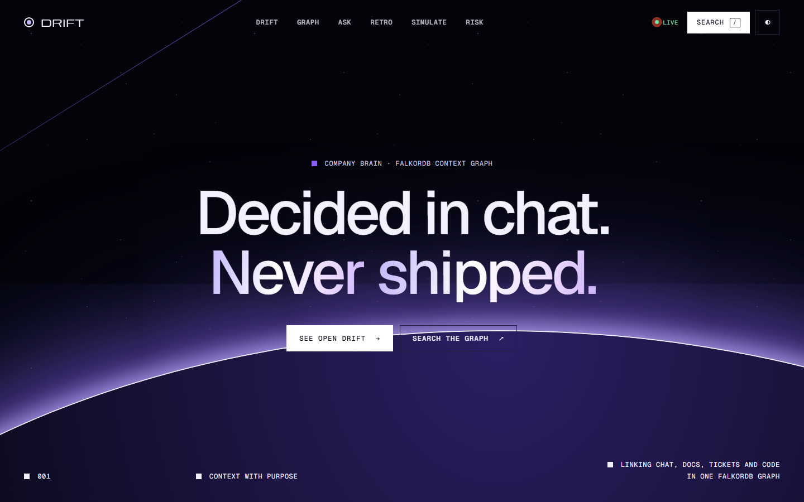
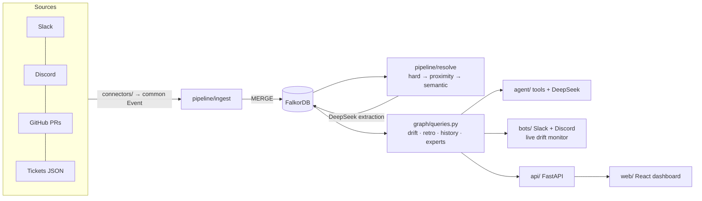
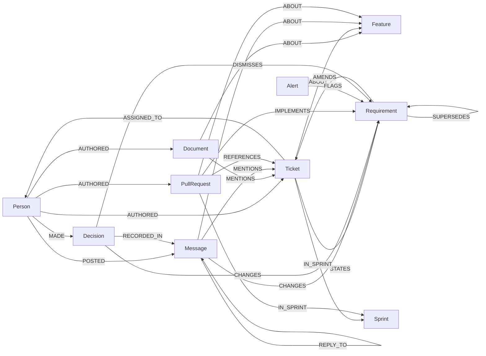

# Context Graph Drift Monitor



> **Graph Hacks: Context for AI Agents** (WeMakeDevs × FalkorDB). Track: **Company Brain**.

Teams make decisions in chat, write requirements in tickets and ship code in pull requests, but nothing links the three. A requirement quietly changes in a Slack thread, the ticket is never updated, and engineering keeps building the old version.

This project builds a **context graph in FalkorDB** that ties Slack and Discord messages, product docs (PRDs, design notes), tickets and GitHub PRs to the same feature and requirement, and then:

1. **Live drift alerts.** When a chat message changes a requirement that the ticket or PRs don't reflect, the bot replies in Slack or Discord with the **graph path** as evidence, including the PRs that shipped the old version and the **docs still describing it**.
2. **Sprint retro.** Shows what we decided, what we shipped and where they diverge, with a source link on every line.
3. **Cited Q&A.** A DeepSeek agent picks from 9 graph tools, and every answer shows the graph paths it used. Without a key, a **rules agent** ([`agent/router.py`](agent/router.py)) routes the question to the same tools by intent (connect, who-knows, PRs, drift, decided/shipped, impact) and builds the answer from their rows. The API, the bots and the dashboard all work either way.
4. **Spec generation.** Turns a drifted feature's graph context into an agent-ready spec. It stops at the spec: nothing executes it.
5. **Coverage and risk.** Finds PRs with no ticket, tickets closed with no code, tickets nobody discussed, and features where one person holds most of the knowledge ("bus factor 1").
6. **Feature timeline.** Puts ticket versions, chat changes and PRs on one time axis and shades the stretch where the ticket and PRs never caught up.
7. **Close the loop.** Each drift card has two actions, and both are written to the graph so they stay auditable. **Write to ticket** makes the decided requirement the ticket's next version (`Ticket -STATES-> new version -SUPERSEDES-> chat requirement`). **Keep old scope** records `Person -MADE-> Decision {kind: dismissal} -DISMISSES-> requirement`. Either way the drift query stops flagging it, and the retro shows the outcome.
8. **Browse the brain.** Press `/` (or Ctrl+K) to search people, tickets, PRs and messages through **FalkorDB full-text indexes** (stemming and prefix match). Person profiles show what someone owns, shipped, decided and knows about, plus any drift they caused or own. Double-click a graph node to expand its neighbours. Deep links: `?person=sofia`, `?q=breach`, `?view=timeline`.

```
(Person maya)-[:POSTED]->(Message @ slack#support-escalations, 2026-09-22)
   -[:CHANGES]->(Requirement "export supports any range up to 12 months + custom fields")
   -[:AMENDS]->(Ticket BD-101)-[:ABOUT]->(Feature "Ticket CSV export")
(PullRequest #6)-[:REFERENCES]->(Ticket BD-101), IMPLEMENTS older "last 30 days as CSV"
```

## Why the graph is doing the work

Drift is a **time-ordered path query**. A requirement that came from chat, that nothing newer **SUPERSEDES**, and that no PR **IMPLEMENTS** is drift. Answering that needs the links between message → requirement → ticket → PR and their order. Plain retrieval over the same text gets you the documents, but not which version is current or which PR implements which version.

### Ablation: switch the graph off, piece by piece

`python -m benchmark.ablation` reruns the whole pipeline on a throwaway graph with one graph capability disabled at a time, then scores it against the answer key. It's deterministic, uses the heuristic extractor and needs no LLM or API key, so the graph structure is the only thing that changes between rows.

| Configuration | Msg→feature P / R | Changes P / R | Drift (requirement) P / R | Stale PRs P / R |
|---|---|---|---|---|
| **Full graph** | 1.00 / 0.92 | 1.00 / 1.00 | **1.00 / 1.00** | **1.00 / 1.00** |
| − thread structure (`REPLY_TO`) | 1.00 / **0.77** | 1.00 / 1.00 | 1.00 / 1.00 | 1.00 / 1.00 |
| − person/time proximity for PRs | 1.00 / 0.92 | 1.00 / 1.00 | 1.00 / 1.00 | 1.00 / 1.00 |
| − version reasoning (`SUPERSEDES` / `IMPLEMENTS`) | 1.00 / 0.92 | 1.00 / 1.00 | **0.50** / 1.00 | **0.67** / 1.00 |
| Ticket IDs only (no threads, proximity or semantic) | 1.00 / **0.33** | 1.00 / **0.50** | 1.00 / **0.00** | 1.00 / **0.00** |

What breaks:
- **Without version reasoning, half the alerts are false.** The 09-15 assignee change and the dark-mode toggle change were both written back into their tickets, but without `SUPERSEDES` there's no way to know the ticket caught up, so both are flagged, and PR #12 is wrongly called stale.
- **With ticket IDs only, both real drifts are missed.** The decisive messages (Maya's 09-22 export decision, the 09-17 SLA decision) never mention a ticket ID. They're reachable only through the thread they sit in and what the thread is about.
- **Without threads,** replies like "How far back do they need?" and "👍 will raise it at standup" lose their feature.
- **Person/time proximity made no difference here:** PR #7's text alone is enough to find BD-102 on this dataset. I'm reporting that as-is; it's a safety net for vaguer PR descriptions.

The LLM benchmark ([Benchmark](#benchmark)) runs the same 15 questions with and without the graph, using the same model and the same data.

## Architecture



| Folder | What's in it |
|---|---|
| [`connectors/`](connectors/) | Slack, Discord, GitHub, mock-ticket and docs (Markdown PRDs and design notes) connectors, plus a scenario replay. They all emit one `Event` format |
| [`pipeline/`](pipeline/) | `ingest` (base graph), `extract` (DeepSeek / oracle), `resolve` (entity resolution + requirement graph), `live` (single-message drift monitor) |
| [`graph/`](graph/) | Connection, writer (idempotent MERGEs), [`queries.py`](graph/queries.py) with every Cypher query the product uses |
| [`agent/`](agent/) | Graph tools, Q&A agent, retro report, spec generator |
| [`bots/`](bots/) | Slack (Socket Mode) and Discord bots |
| [`api/`](api/), [`web/`](web/) | FastAPI backend and a **React + TypeScript** dashboard (Vite, Framer Motion, Cytoscape.js). FastAPI serves the built app |
| [`data/`](data/) | Synthetic scenario, 15 mock tickets, 300 messages, 12 PR specs, **answer key** |
| [`benchmark/`](benchmark/) | Resolution scorer and the graph vs. no-graph benchmark |

## Graph data model



| Node | Key properties |
|---|---|
| `Person` | `id`, `name`, `role` |
| `Message` | `id`, `source` (slack/discord), `channel`, `text`, `ts`, `ts_ms`, `url` |
| `Ticket` | `id`, `title`, `description`, `state`, `versions[]`, `version_times[]`, `desc_updated_ms` |
| `PullRequest` | `id`, `number`, `title`, `body`, `created_ms`, `merged_ms`, `url` |
| `Document` | `id`, `title`, `text`, `created_ms`, `updated_ms`, `url` (PRDs, design notes, RFCs) |
| `Feature` | `id`, `name` |
| `Requirement` | `id`, `text`, `at_ms`, `origin` (ticket/chat), `ticket`, `confidence` |
| `Decision` | `id`, `text`, `at_ms` |
| `Sprint` | `id`, `name`, `start_ms`, `end_ms` |
| `Alert` | `id`, `at_ms`, `status` |

Every node is MERGEd on `id`, so re-ingesting creates no duplicates. Times are stored as epoch-ms integers so Cypher can compare them. Each ticket description version becomes its own `Requirement` (`STATES`), so drift is judged against what the ticket said *at that time*. Resolution edges record **how** they were made (`via: hard | thread | proximity+semantic | semantic:llm | semantic:tfidf`), so every link can be explained.

### Entity resolution (in order)

1. **Hard links.** Ticket IDs in messages (`MENTIONS`) and PRs (`REFERENCES`, for example "Fixes BD-101").
2. **Graph proximity.** Replies inherit their thread's feature. A PR with no ticket ID is matched to tickets **assigned to the PR's author** that were **open at the PR's time**.
3. **Semantic.** DeepSeek picks the feature (or, without an API key, TF-IDF over the feature's ticket and PR text with a threshold). A message that hard-links to a ticket outside every feature is not guessed further.

Requirement changes come from DeepSeek, which classifies each message as decision / requirement_change / request / rejected_proposal / reaffirmation / status / question / other. Only the first two create a `Requirement`, so requests, rejected ideas and reaffirmations don't. Each PR gets `IMPLEMENTS` edges to the requirement versions it actually delivers.

## Cypher queries the product depends on

Full reference with every query, its purpose and its call sites: [`docs/QUERIES.md`](docs/QUERIES.md), generated from the code by `python -m scripts.export_queries`.

All of these live in [`graph/queries.py`](graph/queries.py).

**Drift**: the core query.
```cypher
MATCH (m:Message)-[:CHANGES]->(r:Requirement)-[:AMENDS]->(t:Ticket)-[:ABOUT]->(f:Feature)
WHERE NOT (r)<-[:SUPERSEDES]-(:Requirement)          // still the newest requirement for this ticket
  AND NOT (:PullRequest)-[:IMPLEMENTS]->(r)          // and nothing shipped it
  AND NOT (:Decision)-[:DISMISSES]->(r)              // and nobody chose to keep the old scope
MATCH (author:Person)-[:POSTED]->(m)
OPTIONAL MATCH (pr:PullRequest)-[:REFERENCES]->(t)
OPTIONAL MATCH (pr)-[:IMPLEMENTS]->(old:Requirement) // what those PRs implement instead
RETURN f, t, r, m, author, collect({pr: pr.number, implements: old.text}) AS stale_prs
```

| Query | Used for |
|---|---|
| `DRIFT` | alerts, dashboard, retro "where they diverge", spec context |
| `SPRINT_DECISIONS` | retro: decisions in the sprint window, with shipped / written-into-ticket / open status |
| `SPRINT_SHIPPED` | retro: merged PRs per sprint, their tickets and how each link was resolved |
| `DECISION_HISTORY` | how a feature's requirements evolved: `STATES` / `CHANGES` → `SUPERSEDES` → `IMPLEMENTS` |
| `FEATURE_TIMELINE` | chronological messages, tickets, PRs, requirements for a feature |
| `WHO_KNOWS` | expertise: people ranked by weighted paths to a feature (decision 5, PR 4, ticket 3, message 1) |
| `DECISION_IMPACT` | downstream of a decision: requirement → ticket → owner, PRs, related tickets |
| `ORPHAN_PRS`, `DONE_WITHOUT_PR`, `UNDISCUSSED_TICKETS` | coverage: shipped work with no ticket, closed tickets with no code, tickets no message mentions |
| `KNOWLEDGE_RISK` | per feature, the share of weighted involvement held by the top person (bus factor) |
| full-text search | `CALL db.idx.fulltext.createNodeIndex('Message', 'text')` (plus Ticket, PullRequest, Person) and `CALL db.idx.fulltext.queryNodes($label, $q)` in [`graph/explore.py`](graph/explore.py) |
| `FEATURE_EVENTS` | one `CALL { … UNION … }` subquery that puts ticket versions, chat changes and PRs on a single time axis for the timeline |
| `CONNECTION` | shortest causal chain between any two ids, e.g. `liam` → `PR-6`. This is a bounded undirected search, because FalkorDB's `shortestPath` is directed-only, and it skips the Feature hub so the chain actually explains something |

The `SUPERSEDES` chain is built per ticket in time order ([`supersession_pairs`](pipeline/resolve.py)). A chat change supersedes whatever is current. A later ticket version supersedes earlier ticket versions, but it supersedes a chat change **only if its text actually reflects that change** (DeepSeek `reflects` check). That way an unrelated ticket edit, like a typo fix, can't hide drift. A live change supersedes whichever requirements for that ticket currently have nothing superseding them.

## The synthetic company

Everything is synthetic or owned by the author. See [`data/scenario/company.md`](data/scenario/company.md): **Brightdesk**, a helpdesk SaaS with 8 people and 2 sprints, 300 messages, 15 tickets, 12 PRs and 4 product docs ([`data/docs/`](data/docs/)). Two docs go stale when chat changes the requirement (the export PRD and the SLA design note), the theming RFC is updated minutes after its decision and stays current, and one doc is unrelated.

| Feature | Planted outcome |
|---|---|
| Ticket CSV export | **Drift.** A Slack decision (12-month range + custom fields) never reached BD-101; PR #6 shipped 30 days |
| SLA breach notifications | **Drift.** A Discord decision (warn 15 min *before*, Slack channel, no email) never reached BD-103; PR #5 shipped email-at-breach |
| Dark mode | **Clean control.** The toggle-placement decision was written into BD-105 the same day; PR #12 matches |

The scenario also plants traps: a change that *was* copied into the ticket, a rejected XLSX proposal, a "keep it as is" reaffirmation, a PR with no ticket reference, and a decision made on Discord about work tracked elsewhere. [`answer_key.json`](data/scenario/answer_key.json) records every expected link, change and drift, and all scoring uses it.

## Setup

Requires Python 3.11+ and either Docker (local FalkorDB) or a FalkorDB Cloud instance.

```bash
python -m venv .venv
.venv\Scripts\activate             # macOS/Linux: source .venv/bin/activate
pip install -r requirements.txt
cp .env.example .env               # fill in what you have; every service is optional except FalkorDB

# Local FalkorDB (browser UI on http://localhost:3001)
docker run -d --name falkordb-brain -p 6379:6379 -p 3001:3000 falkordb/falkordb:latest

python -m scripts.check_setup      # PASS/FAIL for FalkorDB, Slack, Discord, GitHub, DeepSeek
```

### Build the graph and open the dashboard

```bash
python -m pipeline.build                      # ingest + extraction + resolution, prints drift (extractor: auto)
python -m benchmark.score_resolution          # precision/recall vs. the answer key
python -m pytest -q                           # unit + end-to-end graph tests (graph tests skip if FalkorDB is down)

cd web && npm install && npm run build && cd ..   # React dashboard -> web/dist (Node 18+)
uvicorn api.main:app --port 8000              # dashboard + API on http://localhost:8000
```

Dashboard URL options: `?theme=light|dark`, `?view=timeline`, `?person=sofia`, `?q=breach`, and `?static` (no entrance animations, for screenshots and projectors). For frontend development, run `npm run dev` in `web/` (Vite on :5173, proxying `/api` to `API_URL`, default `http://localhost:8010`).

The dashboard is React 18 + TypeScript, built with Vite: Framer Motion for motion (split-text hero, scroll reveals, the orbit diagram drawing in, count-ups, drift-card exit animations) and Cytoscape.js for the graph. State lives in one small context ([`web/src/lib/brain.tsx`](web/src/lib/brain.tsx)), and every API shape is typed in [`web/src/lib/api.ts`](web/src/lib/api.ts).

**The LLM is optional.** The code checks whether DeepSeek actually answers (key set *and* a 1-token call succeeds, cached for 5 minutes; see `llm.available()` in [`pipeline/llm.py`](pipeline/llm.py)). If it doesn't, because there's no key, the key is invalid, the balance is zero or the network is down, every feature falls back instead of failing: the build uses the heuristic extractor, Ask uses the rules agent, specs use the template, and the live monitor uses heuristics. The dashboard's spec sheet shows `LLM: online` or `offline (reason)`, and Ask answers say why they came from the rules agent. As soon as the key works, the same commands use DeepSeek.

Three extractors make the language judgments (feature grouping, message classification, which requirement a PR implements, and whether a ticket edit reflects a chat change):

| `--extractor` | What it is |
|---|---|
| `auto` (default) | `deepseek` if the LLM answers, otherwise `heuristic` |
| `deepseek` | LLM calls with JSON output, cached in `data/llm_cache/` |
| `heuristic` | Rules only, with no LLM and no answer key: ticket labels for grouping, sentence-level decision phrasing (questions, rejections and short acks are excluded), number-aware text match for PR→requirement, and the words a ticket edit *added* for "reflects". This is the fallback when there's no key |
| `oracle` | Reads the answer key. A test harness for the graph logic only, never reported as a result |

### Real Slack, Discord and GitHub

```bash
python -m scripts.seed_github     # creates + merges the 12 PRs on your public repo (fresh repo → numbers #1..#12)
python -m scripts.seed_slack      # posts the Slack half of the conversation, in order, as each fictional author
python -m scripts.seed_discord    # same for Discord, via webhooks
python -m pipeline.build --live   # ingest from the real APIs instead of the scenario files
python -m bots.slack_bot          # live drift alerts + @mention commands
python -m bots.discord_bot        # live drift alerts + !brain commands
```

Neither Slack, Discord nor GitHub lets you backdate content. The seeders therefore save a **seed map** (platform message id → scenario message) under `data/seed_maps/`, and PR bodies end with a small `Authored-by / Scenario-created / Scenario-merged` trailer. Connectors use these to restore the original author and time. Messages posted live (by a judge, say) use their real values.

Bot commands: `ask <question>`, `retro s1`, `drift`, `spec feat_export` (`@bot …` in Slack, `!brain …` in Discord).

Daily digest (open drift with graph paths, plus coverage risks), for cron or any scheduler:

```bash
python -m bots.digest --dry-run              # print it
python -m bots.digest --slack C0123456789    # post to Slack
python -m bots.digest --discord 1234567890   # post to Discord (REST, no gateway connection)
```

## Benchmark

| | What it measures |
|---|---|
| `python -m benchmark.score_resolution` | Precision/recall of ticket→feature, message→feature, PR→ticket, requirement changes, drift and stale PRs against the answer key |
| `python -m benchmark.run` | 15 questions ([`questions.json`](benchmark/questions.json)) answered by **graph** (agent + FalkorDB tools) vs. **baseline** (TF-IDF top-25 retrieval over the *same* raw messages, tickets and PRs → same DeepSeek model). Each answer is graded by required facts |

Results are saved in `benchmark/results/latest.json`.

**Heuristic extractor (no LLM, no answer key)**: `python -m pipeline.build --extractor heuristic && python -m benchmark.score_resolution`

| Metric | P | R |
|---|---|---|
| ticket → feature | 1.00 | 1.00 |
| message → feature | 1.00 | 0.92 |
| PR → ticket (incl. PR #7 with no ticket id) | 1.00 | 1.00 |
| requirement changes from chat | 1.00 | 1.00 |
| drift detection | 1.00 | 1.00 |
| stale PRs | 1.00 | 1.00 |

Caveat: I wrote these rules while looking at this synthetic dataset, so treat the numbers as an upper bound, not as generalisation. The rules are listed above so you can judge them yourself.

**Oracle language judgments** (tests the graph logic in isolation):

| Metric | P | R |
|---|---|---|
| ticket → feature | 1.00 | 1.00 |
| message → feature (TF-IDF semantic step) | 1.00 | 0.92 |
| PR → ticket (incl. PR #7 with no ticket id) | 1.00 | 1.00 |
| drift detection | 1.00 | 1.00 |
| stale PRs | 1.00 | 1.00 |

_DeepSeek extraction scores and the graph vs. no-graph results go here once the runs finish._

## Limitations

- **Synthetic, small dataset.** It has 300 messages, 15 tickets and 12 PRs, so it can't show behaviour at company scale.
- **I tried expanding each feature's TF-IDF document with its already-linked chat to catch paraphrases. It didn't help:** any threshold low enough to recover the missed SLA thread also linked 6 noise messages (precision 0.80–0.85), so I reverted it.
- **TF-IDF semantic fallback misses paraphrases.** For example, "email *at* breach is too late" doesn't link to the SLA feature without the LLM. That's why message→feature recall is 0.92 in the table above.
- **Supersession depends on one LLM judgment.** Whether a ticket edit reflects a chat change is a single DeepSeek call per pair, so a wrong "yes" hides drift.
- **Same-ticket scope.** Stale PRs are those that reference the amended ticket. A PR on a sibling ticket of the same feature isn't flagged.
- **The heuristic extractor is phrase-based.** It catches "Decision: …", "let's change …" and "we'll now …", but not a change implied without that phrasing. That's what the DeepSeek extractor is for.
- **Seeded timestamps.** Platform timestamps can't be backdated (see above).

## Future work (out of scope)

Notion, Gong and call recordings; real Linear and Jira connectors; a learning loop from alert feedback; agents executing the generated specs; real-time entity resolution at company scale; FalkorDB vector indexes for the semantic step.

## AI assistant disclosure

This project was built with help from an AI coding assistant (Claude Code), as the hackathon rules allow. The idea, the scenario and the graph model come from my project plan, and I can explain each part of the code, queries and architecture.
