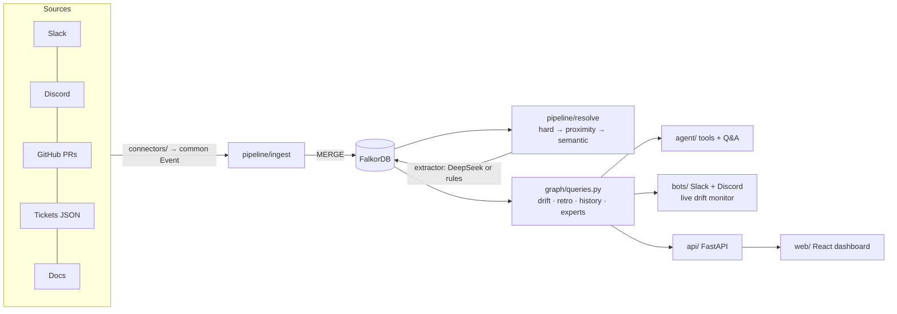
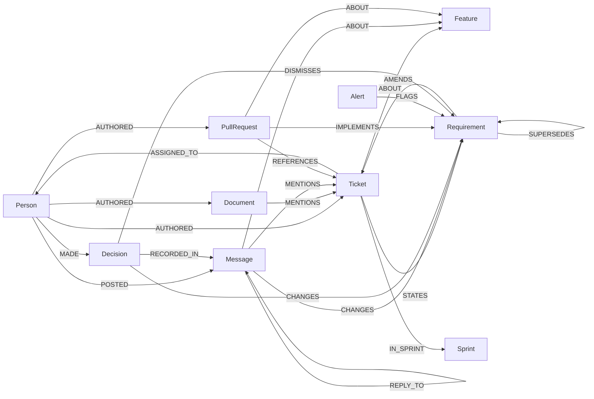

# Context Graph Drift Monitor

> **Graph Hacks: Context for AI Agents** (WeMakeDevs × FalkorDB). Track: **Company Brain**.

Teams make decisions in chat, write requirements in tickets and ship code in pull requests, and nothing links the three. A requirement changes in a Slack thread, the ticket is never updated, and engineering ships the old version. This project builds a **context graph in FalkorDB** that ties chat messages, tickets, PRs and docs to the same feature and requirement. A Cypher path query then finds requirements that changed in chat but never reached the ticket or the code.

<!-- DEMO GIF: record docs/demo.gif with scripts/demo_script.md, then replace this comment with  -->


What one drift alert looks like. The graph path is the evidence:

```
(Person maya)-[:POSTED]->(Message @ slack#support-escalations, 2026-09-22)
   -[:CHANGES]->(Requirement "export supports any range up to 12 months + custom fields")
   -[:AMENDS]->(Ticket BD-101)-[:ABOUT]->(Feature "Ticket CSV export")
(PullRequest #6)-[:REFERENCES]->(Ticket BD-101), IMPLEMENTS older "last 30 days as CSV"
→ BD-101 still says "last 30 days"; PR #6 shipped the old scope; the export PRD is stale.
```

## Known weaknesses

Read these before the numbers. Each one is measured in [Results](#results).

- **Extraction on real text is the weak link.** On two public GitHub repos, the rules extractor flagged 5 drifts, and **all 5 were false** (0/25 labelled items including a decision sample). It mistakes code review, status updates and volunteer proposals for decisions.
- **Noise hides real drift.** With 500 noise messages injected into the demo, the rules extractor finds **0 of the 2 real drifts**. A misread status update supersedes the real decision. One mitigation (decision rights) cuts false requirement changes by 71% but doesn't recover them.
- **The LLM path is unmeasured.** The DeepSeek extractor and the LLM Q&A agent were built to fix exactly the problems above, but the API key has no balance (`402`), so every number here comes from the **rules** path.
- **Without an LLM, the graph doesn't beat plain retrieval on Q&A accuracy.** Dumping the top 25 passages scores 0.978 against the graph's 0.956, with about 4.6× the text. The demo dataset is small enough that retrieval covers almost everything.
- **The demo company is synthetic** (300 messages, 15 tickets, 12 PRs), and I wrote the rules while looking at it. The perfect synthetic scores are an upper bound.

## Features

1. **Live drift alerts.** When a chat message changes a requirement that the ticket and PRs don't reflect, the bot replies in Slack or Discord with the graph path as evidence. The reply names the PRs that shipped the old version and the docs that still describe it.
2. **Sprint retro.** Shows what was decided, what shipped and where the two diverge, with a source on every line.
3. **Cited Q&A.** An agent answers from 9 graph tools and shows the graph paths it used. Without an LLM, a rules agent ([`agent/router.py`](agent/router.py)) routes the question by intent to the same tools.

<details>
<summary>Everything else</summary>

- **Spec generation.** Turns a drifted feature's graph context into an agent-ready spec. Nothing executes it.
- **Coverage and risk.** PRs with no ticket, tickets closed with no code, tickets nobody discussed, and features where one person holds most of the knowledge ("bus factor 1").
- **Feature timeline.** Ticket versions, chat changes and PRs on one time axis. The stretch where the ticket and PRs never caught up is shaded.
- **Close the loop.** Each drift card has two actions, both written to the graph so they stay auditable:
  - **Write to ticket** makes the decided requirement the ticket's next version (`Ticket -STATES-> new version -SUPERSEDES-> chat requirement`).
  - **Keep old scope** records `Person -MADE-> Decision {kind: dismissal} -DISMISSES-> requirement`.
- **Browse the brain.** `/` or Ctrl+K searches through FalkorDB full-text indexes. Person profiles show what someone owns, shipped and decided. Double-click a node to expand its neighbours.
- **Webhooks** for tickets, docs and GitHub PRs keep the graph current. Live updates reach the dashboard over SSE. Details: [`docs/EXTRAS.md`](docs/EXTRAS.md).
- **3D hero, Prometheus metrics, rate limiting, multi-tenancy (one graph per org), daily digest:** [`docs/EXTRAS.md`](docs/EXTRAS.md).

| How drift happens | Open drift with evidence paths | What's in the graph |
|---|---|---|
|  |  |  |

</details>

## Why the graph

Drift is a **time-ordered path query**. A requirement from chat is drift when:
- nothing newer **SUPERSEDES** it;
- no PR **IMPLEMENTS** it;
- nobody chose to keep the old scope (**DISMISSES**).

Answering that needs the links message → requirement → ticket → PR, and their order. Retrieval over the same text finds the documents. It doesn't tell you which version is current or which PR implements which version.

```cypher
MATCH (m:Message)-[:CHANGES]->(r:Requirement)-[:AMENDS]->(t:Ticket)-[:ABOUT]->(f:Feature)
WHERE NOT (r)<-[:SUPERSEDES]-(:Requirement)          // still the newest requirement for this ticket
  AND NOT (:PullRequest)-[:IMPLEMENTS]->(r)          // and nothing shipped it
  AND NOT (:Decision)-[:DISMISSES]->(r)              // and nobody chose to keep the old scope
```

### Ablation: switch the graph off, piece by piece

`python -m benchmark.ablation` → [`benchmark/results/ablation.json`](benchmark/results/ablation.json). It reruns the pipeline with one graph capability disabled at a time and scores it against the answer key. It's deterministic, with the rules extractor and no LLM.

| Configuration | Msg→feature P / R | Changes P / R | Drift (requirement) P / R | Stale PRs P / R |
|---|---|---|---|---|
| **Full graph** | 1.00 / 0.92 | 1.00 / 1.00 | **1.00 / 1.00** | **1.00 / 1.00** |
| − thread structure (`REPLY_TO`) | 1.00 / **0.77** | 1.00 / 1.00 | 1.00 / 1.00 | 1.00 / 1.00 |
| − person/time proximity for PRs | 1.00 / 0.92 | 1.00 / 1.00 | 1.00 / 1.00 | 1.00 / 1.00 |
| − version reasoning (`SUPERSEDES` / `IMPLEMENTS`) | 1.00 / 0.92 | 1.00 / 1.00 | **0.50** / 1.00 | **0.67** / 1.00 |
| Ticket IDs only (no threads, proximity or semantic) | 1.00 / **0.33** | 1.00 / **0.50** | 1.00 / **0.00** | 1.00 / **0.00** |

- **Without version reasoning, half the alerts are false.** Two changes were written back into their tickets, but without `SUPERSEDES` nothing knows the ticket caught up.
- **With ticket IDs only, both real drifts are missed.** The deciding messages never name a ticket. They're reachable only through their thread and what it's about.
- **Person/time proximity made no difference** on this dataset. I'm reporting that as-is.

## Results

Every number below comes from the command shown next to it. Raw output is in [`benchmark/results/`](benchmark/results/).

### 1. Synthetic company: resolution and drift

`python -m pipeline.build --extractor heuristic && python -m benchmark.score_resolution`

| Metric | P | R |
|---|---|---|
| ticket → feature | 1.00 | 1.00 |
| message → feature | 1.00 | 0.92 |
| PR → ticket (incl. PR #7 with no ticket id) | 1.00 | 1.00 |
| requirement changes from chat | 1.00 | 1.00 |
| drift detection | 1.00 | 1.00 |
| stale PRs / stale docs | 1.00 | 1.00 |

I wrote these rules while looking at this dataset, so treat the numbers as an upper bound. [Section 3](#3-real-data-two-public-github-repos) shows what happens on text I didn't write. `--extractor oracle` reads the answer key and tests the graph logic in isolation. It scores the same and is never reported as a result. **DeepSeek extraction: not measured** (`402 Insufficient Balance`).

### 2. Graph vs. no graph (rules agent, no LLM)

`python -m benchmark.run --no-llm` → [`benchmark/results/latest.json`](benchmark/results/latest.json). It runs 15 questions ([`questions.json`](benchmark/questions.json)) over the same messages, tickets and PRs:
- **graph**: the rules agent answering from FalkorDB.
- **top-k**: the k best TF-IDF passages returned verbatim. I report both k=3 and k=25 because k is arbitrary.

The LLM mode (same DeepSeek model on both sides) exists in the same script but couldn't run. The two modes never share a result file.

| System | Mean score | Fully correct | Mean answer length |
|---|---|---|---|
| graph (rules agent, no LLM) | 0.956 | 14 / 15 | 983 chars |
| baseline, extractive top-3 | 0.600 | 6 / 15 | 700 chars |
| baseline, extractive top-25 | **0.978** | 14 / 15 | 4,515 chars |

<details>
<summary>Per-question results</summary>

| | Question | graph | top-3 | top-25 |
|---|---|---|---|---|
| q01 | Which features have a requirement that was changed in chat but never reflected in the ticket? | pass | 0.50 | pass |
| q02 | What is the current requirement for the ticket CSV export? | pass | 0.00 | pass |
| q03 | Does the export that shipped match what was decided? Which PR shipped it? | **0.33** | 0.33 | pass |
| q04 | Who decided that SLA warnings should go to Slack before the breach, and where? | pass | pass | pass |
| q05 | What does BD-103 say and is it still accurate? | pass | 0.67 | 0.67 |
| q06 | Which pull request implemented the SLA notifications, and did it follow the latest decision? | pass | pass | pass |
| q07 | Was the dark mode toggle placement change written back into the ticket? | pass | 0.50 | pass |
| q08 | Is there any drift on the dark mode feature? | pass | 0.00 | pass |
| q09 | Which PR added the export button, and which ticket does it belong to? | pass | pass | pass |
| q10 | Who knows the most about the ticket export feature? | pass | pass | pass |
| q11 | Was XLSX export agreed as a requirement? | pass | pass | pass |
| q12 | What changed in the export requirements on 15 September, and was it shipped? | pass | 0.50 | pass |
| q13 | Who owns BD-101 and which decision makes their shipped work stale? | pass | 0.00 | pass |
| q14 | List the decisions made in Sprint 1 that are not shipped. | pass | pass | pass |
| q15 | Which tickets and PRs are affected by the decision to send SLA warnings 15 minutes before breach? | pass | 0.50 | pass |

</details>

- **The baseline wins q03**, and top-25 ties or beats the graph on every question except q05. On q03 the rules agent read "which PR shipped it" as a PR-listing question. It answered "#6" but never compared the shipped 30-day export with the decision. That's a routing miss in a keyword router, not a missing fact.
- **The graph wins q05**, "is BD-103 still accurate?". That needs the SUPERSEDES/IMPLEMENTS check, not retrieval.
- **What this doesn't show** is that the graph is more accurate than retrieval here. With 300 messages, 25 passages cover nearly every fact. The keyword grader also rewards a dump that contains the right words without ever stating a conclusion.

### 3. Real data: two public GitHub repos

[`benchmark/real_data.py`](benchmark/real_data.py) maps issues to tickets, issue comments to chat and PRs to PRs. It runs the unchanged rules pipeline on a separate graph; no rule or threshold was changed. The repos were fixed before looking at output:
- [FalkorDB/FalkorDB](https://github.com/FalkorDB/FalkorDB), the sponsor's repo.
- [excalidraw/excalidraw](https://github.com/excalidraw/excalidraw), added because FalkorDB alone gave only 5 flags.

The snapshots in [`data/real/`](data/real/) hold the 400 most recent issues and PRs per repo, plus their comments.

```
python -m benchmark.real_data run --repo FalkorDB/FalkorDB      # 216 issues, 31 issue comments, 184 PRs -> drift flags
python -m benchmark.real_data run --repo excalidraw/excalidraw  # 92 issues, 99 issue comments, 308 PRs -> 0 drift flags
python -m benchmark.real_data sample   # 91 of 1,575 comments (issue + PR) classified "decision"; 20 sampled, seed 0
python -m benchmark.real_data score    # precision against benchmark/real_data_labels.json
```

| Labelled set (before decision rights) | Items | True positives | Precision |
|---|---|---|---|
| End-to-end drift flags (all of them, FalkorDB) | 5 | 0 | **0.00** |
| Random sample of "decision" classifications (both repos) | 20 | 0 | **0.00** |

The labels, with a reason for each, are in [`benchmark/real_data_labels.json`](benchmark/real_data_labels.json). The AI assistant made them by reading each comment in full. They haven't been independently checked, so spot-check the URLs. The top 3 failure patterns across all 25 items:

1. **Code review and status (12/25):** reviews, "Agreed, …" replies, "Fixed by #8012", CI tables. `instead of`, `agreed` and `decision` are everywhere in engineering prose.
2. **Analysis that asks for a decision (6/25):** "Prototype fix and measured cost: *needs a decision*."
3. **Volunteer proposals (5/25):** "I'd like to work on this, I'll change X to Y."

On GitHub, requirement changes are rare and most comment volume is PR review: only 130 of the 1,575 fetched comments are on the snapshot's issues. The phrase rules were written for a team chat where decisions are announced, and they don't transfer. Recall wasn't measured: no comment in the snapshots was labelled as a real requirement change.

With the decision-rights rule (next section) on, FalkorDB gives 2 flags instead of 5, and excalidraw still gives 0. Both remaining flags are the issue author's own "needs a decision" write-ups, already labelled false.

### 4. Noise: 500 messages that change nothing

`python -m benchmark.noise` → [`benchmark/results/noise.json`](benchmark/results/noise.json). The demo scenario plus 500 injected messages (seed 0, fixed before the mitigation existed):
- **250 real GitHub comments** from the snapshots.
- **250 on-topic synthetic messages:** status updates, review remarks, volunteer proposals, questions and customer requests, 50 each. I wrote these from the real-data failure patterns, so they are deliberately adversarial.

**One mitigation: decision rights.** A chat message can change a ticket's requirement only if its author created the ticket (`AUTHORED`) or is assigned to it (`ASSIGNED_TO`). This is read from the graph, with no role lists ([`has_decision_rights`](pipeline/resolve.py), also in the live monitor).

| Same noise, rules extractor | Before | After |
|---|---|---|
| Noise messages extracted as requirement changes | 59 | 17 |
| Drift alerts raised | 7 | 6 |
| … of which false | 7 | 6 |
| The 2 real drifts still found | **0 / 2** | **0 / 2** |

The rule removes 71% of the noise "changes" but barely moves the alerts, and it doesn't recover the real drifts. **Noise hides real drift**: a misread later message supersedes the real decision. Ticket owners also write status updates and proposals, so 17 still get through. The synthetic scores, the ablation and the stress test are unchanged with the rule on. That's expected, because all 4 scenario decisions come from ticket creators and I knew that when I chose the rule. That's why the noise numbers are the measurement here.

### 5. Stress test

`python -m benchmark.scale` → [`benchmark/results/scale_200x20000.json`](benchmark/results/scale_200x20000.json). A generated org about 60× the demo: 200 features, 600 tickets, 200 PRs and 20,800 messages. Half the features have planted drift (100 drifts), and the ticket id never appears in the deciding message. Full pipeline, rules extractor, local Docker FalkorDB on a laptop:

| Stage | Result |
|---|---|
| Graph size | 22,940 nodes · 27,700 relationships |
| Ingest (batched `UNWIND`, 500 rows per round-trip) | 1.9 s |
| Resolution | 2.0 s |
| Drift detection | 100 / 100 found, 0 false positives |
| Drift query: whole graph / one ticket | p50 32 ms / 1.3 ms |
| Connection query (`algo.SPpaths`) | p50 3.9 ms |
| Live monitor, one incoming message | p50 20 ms |

The generator writes clean decision messages, so the stress test measures the graph and the queries at size. It doesn't measure extraction. Problems it caught, each now covered by a test or a CI check:
- **Silent truncation at 10k rows.** FalkorDB's Docker image caps result sets, and drift recall silently fell to 0.70. Fixed with paged reads ([`_rows_paged`](pipeline/resolve.py)).
- **Path enumeration blow-up.** The first connection query timed out. Replaced with `algo.SPpaths`.
- **Unlabelled `MATCH (n {id})` scans.** [`scripts/explain_queries.py`](scripts/explain_queries.py) now fails CI on any label scan.
- **TF-IDF scan.** It took 92% of resolve time. An inverted index made it 4.2× faster with identical scores.

How these parts work, and what breaks without them: [`docs/EXPLAIN.md`](docs/EXPLAIN.md).

## Architecture



| Folder | What's in it |
|---|---|
| [`connectors/`](connectors/) | Slack, Discord, GitHub, mock-ticket and docs connectors, plus a scenario replay. All emit one `Event` format |
| [`pipeline/`](pipeline/) | `ingest` (base graph), `extract` (DeepSeek / rules / oracle), `resolve` (entity resolution + requirement graph), `live` (single-message drift monitor), `webhooks` |
| [`graph/`](graph/) | Connection, idempotent batched writers, [`queries.py`](graph/queries.py) with every Cypher query the product uses ([reference](docs/QUERIES.md)) |
| [`agent/`](agent/) | Graph tools, Q&A agent and rules agent, retro report, spec generator |
| [`bots/`](bots/) | Slack (Socket Mode) and Discord bots, daily digest |
| [`api/`](api/), [`web/`](web/) | FastAPI backend and React + TypeScript dashboard |
| [`data/`](data/) | Synthetic scenario with **answer key**, mock tickets, docs, real-repo snapshots |
| [`benchmark/`](benchmark/) | Every measurement in [Results](#results) |

<details>
<summary>Graph data model</summary>



- **Idempotent writes.** Every node is MERGEd on `id`, so re-ingesting creates no duplicates.
- **Integer times.** Times are stored as epoch-ms integers so Cypher can compare them.
- **One node per ticket version.** Each description version becomes its own `Requirement` (`STATES`), so drift is judged against what the ticket said at that time.
- **Explainable links.** Resolution edges record how they were made (`via: hard | thread | proximity+semantic | semantic:llm | semantic:tfidf`).

**Entity resolution, in order:**
1. **Hard links:** ticket ids in text.
2. **Graph proximity:** replies inherit their thread's feature. A PR with no ticket id is matched to tickets assigned to its author that were open at the time.
3. **Semantic:** the LLM's feature choice, or TF-IDF with a threshold.

The `SUPERSEDES` chain is built per ticket in time order ([`supersession_pairs`](pipeline/resolve.py)).

**Extractors** (`--extractor`):
- `auto`: `deepseek` if the LLM answers, otherwise `heuristic`.
- `deepseek`: LLM calls with JSON output, cached.
- `heuristic`: rules only; this is what every reported number uses.
- `oracle`: reads the answer key; a test harness only.

</details>

### The synthetic company

**Brightdesk** ([`data/scenario/company.md`](data/scenario/company.md)) is a helpdesk SaaS with 8 people, 2 sprints, 300 messages, 15 tickets, 12 PRs and 4 docs. Planted outcomes:
- Two drifts: the CSV export (Slack) and the SLA notifications (Discord).
- One clean control: dark mode, where the decision was written back the same day.
- Traps:
  - a change that *was* copied into its ticket;
  - a rejected XLSX proposal;
  - a "keep it as is" reaffirmation;
  - a PR with no ticket reference;
  - a decision made on Discord about work tracked elsewhere.

[`answer_key.json`](data/scenario/answer_key.json) records every expected link, change and drift.

## Setup

Requires Python 3.11+ and Docker (local FalkorDB) or FalkorDB Cloud. Node 18+ for the dashboard.

```bash
python -m venv .venv
.venv\Scripts\activate             # macOS/Linux: source .venv/bin/activate
pip install -r requirements.txt
cp .env.example .env               # every service is optional except FalkorDB
docker run -d --name falkordb-brain -p 6379:6379 -p 3001:3000 falkordb/falkordb:latest
python -m scripts.check_setup      # PASS/FAIL for FalkorDB, Slack, Discord, GitHub, DeepSeek

python -m pipeline.build           # ingest + extraction + resolution, prints drift
cd web && npm install && npm run build && cd ..
uvicorn api.main:app --port 8000   # dashboard + API on http://localhost:8000
python -m scripts.demo_reset       # put the demo back in its starting state (see scripts/demo_script.md)
```

**The LLM is optional.** `llm.available()` ([`pipeline/llm.py`](pipeline/llm.py)) checks that DeepSeek actually answers. If it doesn't (no key, bad key, zero balance, no network), everything falls back instead of failing:
- the build uses the rules extractor;
- Ask uses the rules agent;
- specs use a template;
- the dashboard says which mode it is in.

**Real Slack, Discord and GitHub.** None of these platforms can backdate content, so the seeders save a seed map that the connectors use to restore the original author and time.

```bash
python -m scripts.seed_github && python -m scripts.seed_slack && python -m scripts.seed_discord
python -m pipeline.build --live    # ingest from the real APIs
python -m bots.slack_bot           # live drift alerts + @mention commands (bots.discord_bot for Discord)
```

The connectors are tested against fake Slack, Discord and GitHub APIs ([`tests/test_connectors.py`](tests/test_connectors.py)). I haven't run them against real workspaces for this submission.

### Tests and CI

`python -m pytest -q` runs 53 tests, none of which need an LLM or API keys:
- units, plus the benchmark grader, baselines, real-data adapter and noise set;
- end-to-end graph tests on throwaway graphs;
- HTTP tests of the API and webhooks;
- connector contract tests;
- a paging regression test.

[`.github/workflows/ci.yml`](.github/workflows/ci.yml) runs on every push against a FalkorDB service container. Besides the tests, it:
- reruns the ablation;
- checks query plans for index use;
- runs a smaller stress test;
- checks that `docs/QUERIES.md` matches the code;
- builds the React app.

## Limitations

- **Real-text extraction:** 0/25 precision on real GitHub data, and noise hides real drift. See Results 3 and 4.
- **Unmeasured LLM path.** It's the intended fix for the above, and the reason the rules exist only as a fallback.
- **Lenient Q&A grader.** It's keyword-based, so it rewards a passage dump that contains the right words.
- **Decision rights is coarse.** A lead who decides on someone else's ticket is ignored. GitHub issue authors who write "needs a decision" still pass.
- **TF-IDF misses paraphrases.** "Email *at* breach is too late" doesn't link to the SLA feature without the LLM (message→feature R = 0.92).
- **Same-ticket scope.** A PR on a sibling ticket of the same feature isn't flagged as stale.
- **Single-version issues.** GitHub's REST API has no issue-body edit history, so in the real-data run each issue is a single version.

## AI assistant disclosure

This project was built with help from an AI coding assistant (Claude Code), as the hackathon rules allow. The idea, the scenario and the graph model come from my project plan, and I can explain each part of the code, queries and architecture ([`docs/EXPLAIN.md`](docs/EXPLAIN.md)). The real-data labels were made by the assistant and are marked as such.
