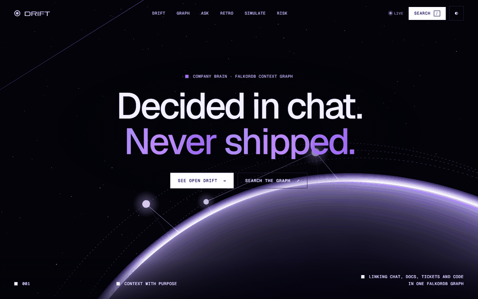
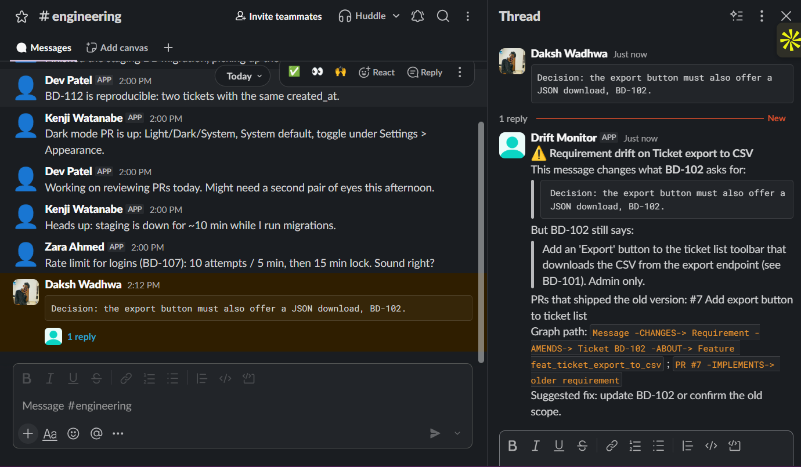

# Context Graph Drift Monitor

> **Graph Hacks: Context for AI Agents** (WeMakeDevs × FalkorDB). Track: **Company Brain**.

**Decisions change in chat. Tickets keep the old text, and PRs ship the old version.** This agent keeps a FalkorDB context graph of a team's Slack, Discord, tickets, GitHub PRs and docs. When an owner decides something new in chat and nothing newer replaces it, no PR ships it, and nobody keeps the old scope, it replies **in the thread** with the graph path as evidence, and then gets the fix done.

[Full results](docs/RESULTS.md) · [Architecture, setup and tests](docs/DETAILS.md) · [Every query](docs/QUERIES.md) · [How it works](docs/EXPLAIN.md)



**In a real Slack workspace**, a ticket owner's message got this in-thread alert within seconds:



## What the company brain answers

| Question | How the graph answers it |
|---|---|
| **Did we ship what we decided?** | Drift: a chat requirement nothing `SUPERSEDES`, no PR `IMPLEMENTS`, nobody `DISMISSES` |
| **Who decided it, where, and what did it replace?** | The decision's message, author, channel and the version chain it amends |
| **Who owns this, who knows the most?** | Ticket owners, people ranked by decisions > PRs > tickets > messages, and the bus factor |
| **How are these two connected?** | The shortest causal path (`algo.SPpaths`), e.g. a support agent's message → a thread → a ticket → a PR |
| **What has to happen now, and who does it?** | A fix plan: the ticket, every stale PR and doc, each assigned to its author |
| **What did the sprint decide, ship and leave behind? What has no paper trail?** | Sprint retro; PRs with no ticket, closed tickets with no PR, tickets nobody discussed |

## The agent gets work done

It doesn't stop at the alert. In the alert thread ([`pipeline/work.py`](pipeline/work.py)):

```
zara:  @Drift Monitor fix it
bot:   🔒 Only BD-102's owners can decide this: Maya Chen (created it) or Kenji Watanabe (assigned). zara can't.
maya:  @Drift Monitor plan
bot:   1. Write the decision into BD-102 (done by me when an owner approves)
       2. Change PR #7 "Add export button to ticket list" to the new requirement → kenji
       3. Update DOC-1 "PRD — Ticket export" → maya
       Also tell: sofia, arjun, liam. Who can approve: Maya Chen or Kenji Watanabe.
maya:  @Drift Monitor fix it
bot:   ✅ Done. BD-102 now carries the decision. Follow-ups opened: T-1 → kenji, T-2 → maya
```

- **The plan is a graph read:** who wrote each stale PR and doc, who owns the ticket, who else is involved.
- **Only owners decide.** Approving writes the decision into the ticket and opens follow-up `Task` nodes assigned to the right people. They survive every rebuild.
- **Same actions** in Slack and Discord threads, on the dashboard ("Fix plan", "Approve fix", "Open follow-ups") and in Q&A.
- **Guardrails:** 11 fixed graph tools on read-only `GRAPH.RO_QUERY`; an LLM answer naming an id no tool returned is replaced by the grounded one; "I couldn't find BD-999 in the graph" instead of a guess.

The refusal and plan are the agent's actual replies on the live-Slack graph; the flow is tested in [`tests/test_work.py`](tests/test_work.py).

## Why it needs a graph

Drift is a **time-ordered path question**. Every ticket version and chat change is its own `Requirement`, linked by `SUPERSEDES`:

```cypher
MATCH (m:Message)-[:CHANGES]->(r:Requirement)-[:AMENDS]->(t:Ticket)-[:ABOUT]->(f:Feature)
WHERE NOT (r)<-[:SUPERSEDES]-(:Requirement)   // still the newest version
  AND NOT (:PullRequest)-[:IMPLEMENTS]->(r)   // nothing shipped it
  AND NOT (:Decision)-[:DISMISSES]->(r)       // nobody kept the old scope
```

- **Context that ids miss:** the deciding messages never name a ticket; threads, people and time connect them. With ticket ids only, both real drifts are missed.
- **Version reasoning:** switch off `SUPERSEDES`/`IMPLEMENTS` and half the alerts become false (precision 1.00 → 0.50). CI fails if that regresses.
- **Evidence with every answer,** and **multi-hop paths** (`algo.SPpaths`, p50 6.1 ms at 22,940 nodes).

| FalkorDB feature | Used for |
|---|---|
| Cypher anti-patterns | The drift query, with its evidence in the same query ([`graph/queries.py`](graph/queries.py)) |
| `algo.SPpaths` | "How is X connected to Y?", answered with the path |
| Variable-length paths `[:REPLY_TO*1..5]` | The live monitor inherits context from the thread |
| `GRAPH.RO_QUERY` | Every agent tool is read-only |
| Full-text and range indexes, `GRAPH.EXPLAIN` | Search; CI fails on any label scan |
| `UNWIND … MERGE`, one graph per tenant, paging | Idempotent ingest, isolated orgs, no truncation at scale |

Honest boundary: with the same extracted facts and version chain, a SQL anti-join finds the same drift. The graph's job is the model, the evidence, the traversal and the actions ([Results §2](docs/RESULTS.md#2-graph-vs-a-relational-baseline)).

## Proof it runs

- **Real Slack:** a decision posted in a real workspace got the in-thread alert above; a rebuild from Slack history found it too ([`docs/REAL_RUN.md`](docs/REAL_RUN.md)).
- **Real GitHub:** a merged PR, [brightdesk-demo#1](https://github.com/Dakshhhhh-ops/brightdesk-demo/pull/1), read through the GitHub API, closed the BD-103 drift via `IMPLEMENTS`.
- **Real repos:** 289 real comments from FalkorDB and Excalidraw searched; all 81 flags checked against their GitHub threads: **0 confirmed drift**. The two genuine scope decisions found had already reached a PR ([results §7](docs/RESULTS.md#7-looking-for-real-drift-in-real-repos)).
- **Scale:** 100 of 100 planted drifts in a 22,940-node graph, 0 false; drift query p50 39 ms.
- **Tested:** 120 tests, CI with ruff, mypy, the ablation gate and a query-plan check.

## Results at a glance

From [`docs/RESULTS.md`](docs/RESULTS.md). gpt-oss-120b = OpenAI's open-weight model on Groq's free tier; qwen3:8b = a small local model.

| Measurement | Result |
|---|---|
| Synthetic company (300 messages): drift P / R | **1.00 / 1.00** (rules and qwen3:8b) |
| Q&A, gpt-oss-120b agent over the graph / retrieval into the same model | **0.84** / 0.71 |
| Q&A, rules agent (no LLM) / raw top-25 passages | 0.86 / **0.98** (the dump is five times longer) |
| Real GitHub text, rules / gpt-oss-120b | false positives still flagged 25/25 / **2/25**; recall 1/7 / **2/7** |
| 500 noise messages, rules / qwen3:8b | both real drifts found; 14 / **1** false alerts |
| Stress test, 22,940 nodes | **100 / 100** planted drifts |
| Real drift search, FalkorDB + Excalidraw (289 comments) | 81 flags checked by hand, **0 confirmed drift** |

## Known weaknesses

- **Extraction on real text is the weak link, and it is tuned for precision on purpose.** On real GitHub text gpt-oss-120b was right every time it flagged something (precision 1.00) but found only 2 of 7 real decisions. For a bot that posts into people's threads that is the right trade-off: a false alert is spam and costs trust, a missed one costs nothing new. And nothing changes without a ticket owner approving it. The real-data labels were made by the AI assistant; 0 of 25 re-checked by me.
- **Written against the test data:** the rules, prompts and thresholds were tuned on the synthetic company, so its 1.00s are an upper bound.
- **Small demo:** two real drifts; "half the alerts are false" is 2 of 4.
- **The live runs used the synthetic company's messages** and one PR I wrote, in a one-person workspace.

Full list: [`docs/RESULTS.md`](docs/RESULTS.md#limitations).

## Quick start

```bash
pip install -r requirements.txt && cp .env.example .env
docker run -d -p 6379:6379 falkordb/falkordb:v4.22.1
python -m pipeline.build                       # build the graph, print drift
cd web && npm install && npm run build && cd ..
uvicorn api.main:app --port 8000               # dashboard on http://localhost:8000
```

The LLM is optional (rules otherwise). LLM setup, real Slack/GitHub, Docker/Render and the test list: [`docs/DETAILS.md`](docs/DETAILS.md).

## AI assistant disclosure

Built with help from an AI coding assistant (Claude Code), as the hackathon rules allow. The idea, the scenario and the graph model come from my project plan, and I can explain every part ([`docs/EXPLAIN.md`](docs/EXPLAIN.md)). The real-data labels were made by the assistant and are marked as such.
