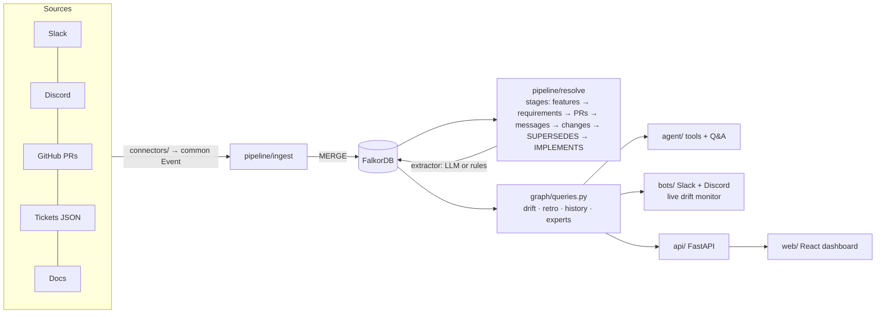
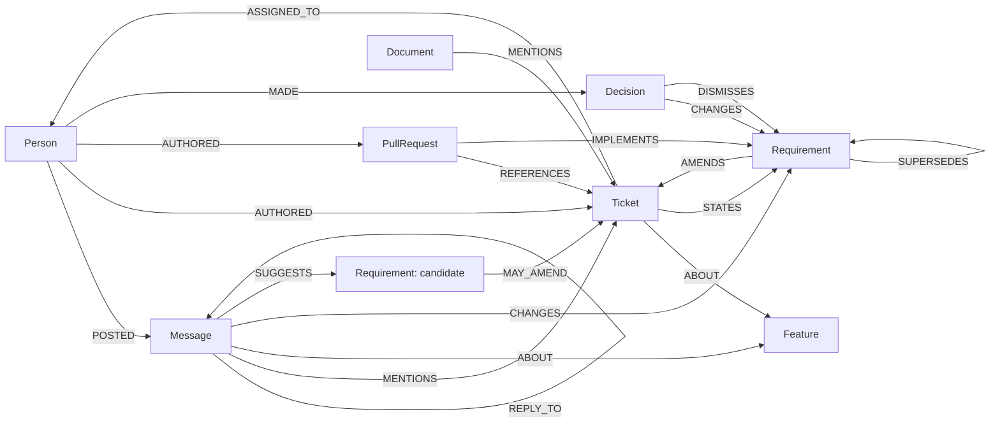

# Details: architecture, setup, tests

The [README](../README.md) is the short version. This page has the reference material.

## What one alert means

The graph path is the evidence:

```
(Person maya)-[:POSTED]->(Message @ slack#support-escalations, 2026-09-22)
   -[:CHANGES]->(Requirement "export supports any range up to 12 months + custom fields")
   -[:AMENDS]->(Ticket BD-101)-[:ABOUT]->(Feature "Ticket CSV export")
(PullRequest #6)-[:REFERENCES]->(Ticket BD-101), merged after the decision but IMPLEMENTS the older "last 30 days as CSV"
→ BD-101 still says "last 30 days"; PR #6 shipped the old scope; the export PRD is stale.
```

## Architecture



| Folder | What's in it |
|---|---|
| [`connectors/`](../connectors/) | Slack, Discord, GitHub, mock-ticket and docs connectors, plus a scenario replay. All emit one `Event` format |
| [`pipeline/`](../pipeline/) | `ingest`, `extract` (LLM / rules / oracle), `resolve` (one function per stage), `human` (actions that survive rebuilds), `live`, `webhooks` |
| [`graph/`](../graph/) | Connection, idempotent batched writers, [`queries.py`](../graph/queries.py) with every Cypher query ([reference](QUERIES.md)) |
| [`agent/`](../agent/) | Graph tools, LLM agent and rules agent, retro, spec generator |
| [`bots/`](../bots/) | Slack (Socket Mode) and Discord bots, daily digest |
| [`api/`](../api/), [`web/`](../web/) | FastAPI backend and React + TypeScript dashboard |
| [`benchmark/`](../benchmark/) | Every measurement in [`docs/RESULTS.md`](RESULTS.md), including the SQL baseline |
| [`config.py`](../config.py) | Every tuning constant, with the reason for its value |

<details>
<summary>Graph data model, resolution and extractors</summary>



- **Idempotent writes.** Every node is MERGEd on `id`.
- **Integer times.** Times are epoch-ms integers.
- **One node per ticket version.** Each ticket version is its own `Requirement`.
- **Explainable links.** Every resolution edge records `via`.
- **Human actions** carry `origin: 'human'`. Only extractor-made decisions are deleted on rebuild.

**Requirement changes** come from messages by someone with **decision rights** (the ticket's creator or assignee), at confidence ≥ `MIN_CONFIDENCE`. **The LLM extractor** returns structured output with an `evidence_quote`, which must appear literally in the message or the extraction is discarded.

**Extractors** (`--extractor`):
- `auto`: `llm` if the LLM answers, otherwise `heuristic`.
- `llm` (alias `deepseek`): any OpenAI-compatible model.
- `heuristic`: the rules.
- `oracle`: the answer key; a test harness only.

</details>

## The synthetic company

**Brightdesk** ([`data/scenario/company.md`](../data/scenario/company.md)) is a helpdesk SaaS with 8 people, 2 sprints, 300 messages, 15 tickets, 12 PRs and 4 docs.
- **Two drifts:** the CSV export (Slack) and the SLA notifications (Discord).
- **One clean control:** dark mode.
- **Traps:**
  - a change copied into its ticket;
  - a rejected XLSX proposal;
  - a "keep it as is" reaffirmation;
  - a PR with no ticket reference;
  - a decision on Discord about work tracked elsewhere.

[`answer_key.json`](../data/scenario/answer_key.json) records every expected link, change and drift.

## Setup

Requires Python 3.11+, Docker (local FalkorDB) or FalkorDB Cloud, and Node 18+ for the dashboard.

```bash
python -m venv .venv
.venv\Scripts\activate             # macOS/Linux: source .venv/bin/activate
pip install -r requirements.txt
cp .env.example .env               # every service is optional except FalkorDB
docker run -d --name falkordb-brain -p 6379:6379 -p 3001:3000 falkordb/falkordb:v4.22.1
python -m scripts.check_setup      # PASS/FAIL per service; for Slack it names any missing scope

python -m pipeline.build           # ingest + extraction + resolution, prints drift
cd web && npm install && npm run build && cd ..
uvicorn api.main:app --port 8000   # dashboard + API on http://localhost:8000
python -m scripts.demo_reset       # put the demo back in its starting state (see scripts/demo_script.md)
```

**The LLM is optional, and it can be local.** Any OpenAI-compatible endpoint works. For a free, offline, reproducible run with [Ollama](https://ollama.com), set these in `.env`:

```bash
ollama pull qwen3:8b
LLM_BASE_URL=http://localhost:11434/v1
LLM_MODEL=qwen3:8b
LLM_API_KEY=ollama
LLM_REASONING_EFFORT=none   # skip qwen3's thinking phase, about 15x faster
```

The strong-model numbers used Groq's free tier:

```bash
LLM_BASE_URL=https://api.groq.com/openai/v1
LLM_MODEL=openai/gpt-oss-120b
LLM_API_KEY=gsk_...
LLM_REASONING_EFFORT=low
LLM_MAX_RETRIES=10          # the free tier allows 8,000 tokens a minute
```

Unset, it uses DeepSeek (`DEEPSEEK_*`). Every extraction call is cached by (model, prompt) in `data/llm_cache/`, which is committed, so the qwen3 and gpt-oss **extraction** numbers (resolution, noise, real data) reproduce without a GPU or key. The **Q&A** numbers don't: the agent's calls aren't cached, so re-running them needs the model (Ollama or a key). When no LLM answers, everything falls back instead of failing.

**Real Slack, Discord and GitHub:** see [`docs/REAL_RUN.md`](REAL_RUN.md). `build --live` reads each configured source from its API, falls back to the scenario files for the rest, and prints which is which.

## Connect Slack and Discord from the website

The overview page has **Add to Slack** and **Add to Discord** buttons ([`api/integrations.py`](../api/integrations.py)). Until the server has the settings below, they are greyed out and say what's missing.

**Slack** (any workspace, through Slack's OAuth consent page):
1. In your Slack app: Basic Information → App Credentials → `SLACK_CLIENT_ID`, `SLACK_CLIENT_SECRET`.
2. OAuth & Permissions → Redirect URLs → add `<PUBLIC_URL>/api/connect/slack/callback`. Slack wants HTTPS: use the deployed URL, or a tunnel (`cloudflared tunnel --url http://localhost:8010`) and set `PUBLIC_URL` to it.
3. To let other workspaces install it: Manage Distribution → activate public distribution.
4. After "Allow", the site lists the workspace's public channels; the ones you tick are joined (`channels:join`). The bot (`python -m bots.slack_bot`, Socket Mode) serves every installed workspace plus the one in `SLACK_BOT_TOKEN`. Tokens are kept server-side in `data/installs.json` (git-ignored); `/api/integrations` never returns them. In production that file belongs in a secret store.

**Discord** (one bot, any server):
1. Discord Developer Portal → New Application → Bot → token into `DISCORD_BOT_TOKEN`; switch on the Message Content intent.
2. Run `python -m bots.discord_bot`. The "Add to Discord" button opens Discord's page for adding the bot to a server (the application id is read from the token, or `DISCORD_CLIENT_ID`). The running bot records the servers it's in, and the site shows them as connected.

**Every team gets its own graph** ([`connectors/installs.py`](../connectors/installs.py)). Only the home workspace (the one in `SLACK_BOT_TOKEN`) and the home server (`DISCORD_GUILD_ID`) feed the demo company's graph. Any other workspace or server gets a private org with a random id (`slack-3f9a1c7e2b`), so its messages go into its own graph: it never sees or feeds the demo or another team. The bot posts one welcome there with that team's dashboard link. The public site only shows how many teams are connected; channel picking needs a two-hour setup key that only the installer's redirect carries; and a team's graph can't be reset to demo data (`403`).
With no sign-in, the org id in the dashboard link is the only key to a team's graph.

## Using it for your own team

A connected team's dashboard (the link in the bot's welcome) opens on **Your setup**, and from there the team gets what the demo company has: real people with roles, their real tickets and PRs, and drift alerts in their threads.

**People and roles** ([`pipeline/identity.py`](../pipeline/identity.py)). The demo company's people are hand-written (`people.json`); a real team's come from its systems:
- **Slack:** every member of the workspace (`users.list`): name, job title (the profile's *Title* field becomes the role), email, admins, and Slack user groups (they decide who may see restricted documents). New members (`team_join`) and profile changes (`user_change`) update the graph as they happen; every sync re-reads the directory too.
- **Discord:** a member's display name, their top server role as role, and their roles as groups.
- **GitHub:** issue and PR authors, assignees and commenters, with their public name and email.
- **Jira and Linear:** reporters, creators, assignees and commenters (display name and email; Jira hides emails unless the user allows it, so those are matched by full name).
- **One person per human:** accounts are linked by email, then full name, then handle (GitHub `maya-chen` and Slack `maya.chen`), and the page shows how each was linked. A missed link is fixed with *Merge*, a role or groups set by hand are kept over later syncs, and bots (dependabot, Copilot) are not people. This matters because only a ticket's creator or assignee can change it from chat: Maya's Slack decision counts on the issue Maya opened on GitHub.

**Their work.** Tickets come from whichever tracker the team uses, PRs from GitHub; each source is connected on the setup page and kept in sync ([`connectors/work.py`](../connectors/work.py) is what they share). Every ticket without a feature group becomes a feature of its own, so one-off issues are tracked too (the demo keeps its grouping).

| Source | Tickets | Description history | Comments | Connect with |
|---|---|---|---|---|
| **GitHub** ([`github_work.py`](../connectors/github_work.py)) | issues as `GH-<n>` ("#12" anywhere links as `GH-12`), plus every PR | the text at connection, then each later edit (GitHub's REST API keeps no older ones) | issue comments | repo + read-only token (Issues, Pull requests, Metadata); a public repo works without one |
| **Jira Cloud** ([`jira.py`](../connectors/jira.py)) | one project's issues, `ACME-12` | **all of it**, from the changelog: every version, its author and time | issue comments | site, account email, API token, project key |
| **Linear** ([`linear.py`](../connectors/linear.py)) | one team's issues, `ENG-12` | the current text dated to its last edit (Linear's history has the time, not the old text), then each later edit | issue comments | personal API key, team key |

PRs come from GitHub whichever tracker is used: "Fixes ENG-12" or "ACME-12" in a PR links it to the Linear or Jira ticket, as "BD-101" does in the demo. Ticket ids are recognised in chat when the key has two to five letters; a longer Jira key (`ACMECORP-12`) still syncs, but isn't linked from a chat message.

**Staying current** ([`pipeline/teamsync.py`](../pipeline/teamsync.py)). A new message reaches the graph at once, with the in-thread alert. Every `TEAM_SYNC_SECONDS` (default 300) a pass per team re-reads the Slack directory and fetches only what changed on GitHub since the previous pass. An issue whose body changed gets its next version, stamped with the time of the change, and the pass re-derives features, requirement versions, `SUPERSEDES`, `IMPLEMENTS` and drift; follow-up tasks, write-backs and dismissals are kept. Edited and deleted Slack and Discord messages are picked up too (an edit is checked like a new message; a deletion removes what it implied at the next pass). Picking channels imports their last 90 days once. *Sync now* runs a pass at once.

**Slack app settings this needs:** bot events `message.channels`, `app_mention`, `user_change`, `team_join`; scopes as requested by *Add to Slack* (including `users:read.email` and `usergroups:read`, used to match people and groups). **Discord:** the Message Content intent; for role changes as they happen, the Server Members intent too and `DISCORD_MEMBERS_INTENT=1`.

**Jira and Linear** are tested end to end against fake APIs in [`tests/test_trackers.py`](../tests/test_trackers.py): a Jira issue's whole description history (each version by its author), its comment as discussion, the reporter matched to their Slack account by name, and the reporter's Slack decision raising drift on `ACME-1`; a Linear issue's text dated to its last edit, the assignee's Slack decision raising drift on `ENG-1`, and the edit in Linear closing it. They have not run against a real Jira site or Linear workspace yet.

**Measured on a real repo:** a full sync of `FalkorDB/falkordb-py` (65 issues, 241 PRs, 11 comments, 35 people) took about two minutes with the LLM extractor and grouped them into 66 features, with 37 PRs linked to the requirement versions they implement; a pass with nothing new took 2 s. Tested end to end with fake Slack and GitHub APIs in [`tests/test_team.py`](../tests/test_team.py): a Slack decision by the issue's creator raises the drift alert, the issue edit on GitHub closes it, and a non-owner's decision is refused.

**Not covered yet:** other trackers (Asana, ClickUp, Shortcut), GitHub and Linear ticket text from before the connection (their APIs keep no old versions; Jira's does), a team's own documents (the Google Drive connector is server-wide), and sign-in (the dashboard link is the key).

## MCP server for coding agents

[`agent/mcp_server.py`](../agent/mcp_server.py) exposes the graph to any MCP client as six read-only tools, thin wrappers
over [`agent/tools.py`](../agent/tools.py) (every query is `GRAPH.RO_QUERY`, every answer redacted for the viewer):

| Tool | Returns |
|---|---|
| `current_spec(ticket)` | the newest requirement for the ticket and where it came from (who, which channel, when, the message), what the ticket still says, PRs that shipped the old version, stale docs, owners, who knows the feature best, and the graph paths. Status `TICKET_OUT_OF_DATE` or `CURRENT`. |
| `drift(feature?)` | open drift, optionally for one feature (id, name or ticket id) |
| `who_knows(topic)` | people ranked by involvement (ticket id, feature id or name, or a few words) |
| `decision_history(topic)` | every requirement version and chat change, what replaced what, which PR implements which |
| `impact(target, days)` | downstream projects, client deliverables and teams a delay reaches |
| `find(query)` | ticket and feature ids from a few words |

The server's instructions tell the agent to call `current_spec` before implementing a ticket and to build what it
returns, not the ticket text. On a public repo's graph ("Try it on your repo"), `current_spec` adds the rules
extractor's caveat and any earlier hand-check of the flag.

- **Hosted:** the API serves it at `/mcp` (streamable HTTP, stateless JSON). `X-Org` (or `?org=`) picks the graph, `X-User` (or `?as=`) the viewer. `claude mcp add --transport http company-brain https://<host>/mcp [--header "X-Org: <org>"]`.
- **Local:** `claude mcp add company-brain -- python -m agent.mcp_server` (stdio; `BRAIN_ORG`, `BRAIN_USER`).

The before/after example is [`examples/mcp-demo`](../examples/mcp-demo): a stub `export_csv`, the BD-101 ticket as the
tracker shows it, and two recorded Claude Code runs of "implement BD-101", without and with the server
([`RUNS.md`](../examples/mcp-demo/RUNS.md)). Tested over the real HTTP transport in [`tests/test_mcp.py`](../tests/test_mcp.py).

## Try it on your own repo

`POST /api/try {repo}` (or `/try/<owner>/<name>` in a browser) builds a public GitHub repo's graph in the background
([`pipeline/tryrepo.py`](../pipeline/tryrepo.py)); `GET /api/try/status?repo=` polls it.

- **Window:** the `TRY_ISSUES` most recently updated issues (150) and `TRY_PRS` PRs (100), up to `TRY_REF_ISSUES` older issues those PRs name (25, only with a server `GITHUB_TOKEN`: without one GitHub allows 60 calls an hour), and `TRY_COMMENT_PAGES` × 100 recent comments (4). Bots are left out.
- **Pipeline:** the real-data adapter ([`benchmark/real_data.py`](../benchmark/real_data.py)): issue → `Ticket GH-<n>`, issue comment → `Message` that mentions it, PR → `PullRequest`; then `resolve` with the rules extractor and one feature per issue. PR comments add `REVIEWED` edges for "who knows".
- **What the page shows:** people; who knows what per label (opened 1, commented 1, assigned 2, wrote a PR for it 3); issue ← PR chains; open issues no PR names; decisions in comments; drift; a layered graph; a link to the full dashboard on that graph (read-only) and the MCP command for it.
- **Guards:** private repos are refused (the server token could read them), two builds at a time, results reused for `TRY_TTL_HOURS` (12), at most `TRY_MAX_REPOS` graphs kept (40). `TRY_PREWARM` (FalkorDB/FalkorDB) is built at startup, from the bundled snapshot if GitHub can't be reached. Every write endpoint answers 403 on a repo's graph.
- **Honest part:** decisions and drift come from the rules extractor, whose precision on 60 hand-labelled real comments was 0.17; the page says so, and shows the earlier verdict next to a flag that was already labelled. On FalkorDB/FalkorDB both drift flags are known false positives.

Tested with a fake GitHub in [`tests/test_tryrepo.py`](../tests/test_tryrepo.py).

## Deploy (Docker / Render)

One image runs FalkorDB v4.22.1, the API and the built dashboard ([`Dockerfile`](../Dockerfile)); the graph is rebuilt from the synthetic company on every start.

```bash
docker build -t drift-monitor . && docker run -p 8000:8000 drift-monitor   # http://localhost:8000
```

On Render: New → Blueprint → this repo ([`render.yaml`](../render.yaml)). It runs as a public sandbox: without `INGEST_TOKEN`, visitors can resolve drifts, and a restart resets the demo. Set `INGEST_TOKEN` to require a token (the dashboard sends it from a `?token=` link).

## Documents, embeddings and access control

| Setting | Meaning |
|---|---|
| `EMBED_BASE_URL`, `EMBED_MODEL`, `EMBED_API_KEY` | Any OpenAI-compatible `/embeddings` endpoint for document chunks. Unset: a local 1024-dimension hashed embedding (lexical, free, offline). Changing it re-embeds everything on the next sync. |
| `GOOGLE_ACCESS_TOKEN` | OAuth token with `drive.readonly`, for `python -m connectors.gdrive sync` |
| `GDRIVE_CHANNEL_TOKEN` | Secret checked on Drive push notifications to `POST /api/ingest/gdrive` |

- **Restricting a doc:** add `access: leads, hr` to a doc's frontmatter, send `acl` to `POST /api/ingest/doc`, or share it in Google Drive. Grants are group names (from `groups` in `people.json`) or `person:<id>`; Drive sharing becomes `email:<address>` grants (a person's grants include their `email`). A restricted doc's author always keeps access.
- **Who is asking:** `X-User: <person id>` on the API (`?as=` also works), the chat user in Slack and Discord. Without one, the viewer is anonymous and sees only unrestricted content. The LLM agent is told who is asking, and its first step must call a tool, so it never answers from memory.
- **Counts follow the viewer:** `/api/stats` leaves out documents the viewer can't see, their chunks and their edges. `GET /api/docs` lists docs with their access, chunks and stale flags; `GET /api/whoami` shows a viewer's grants. Editing a doc you can't see (`POST /api/ingest/doc` with `X-User`) answers 404, as for a doc that doesn't exist.
- **The demo data** includes one restricted doc, [`data/docs/hr-comp-bands.md`](../data/docs/hr-comp-bands.md) (`access: leads, hr`): maya and arjun (leads) can see it, everyone else can't.

## Impact analysis and feature maps

The org layer ([`data/scenario/org.json`](../data/scenario/org.json), written by [`graph/writer.py`](../graph/writer.py) `write_org`):

```
Person -MEMBER_OF-> Team            Person -OWNS-> Project -INCLUDES-> Ticket -BLOCKS-> Ticket
Deliverable -FOR-> Client           Deliverable -NEEDS-> Project       Person -OWNS-> Deliverable
Message -CONCERNS-> Client          (a message that names the client)
```

In a real company: Linear projects and their target dates, or Jira versions; "blocks" issue links; the HR system or GitHub teams; the CRM for clients and what was promised to them. Replace the file with your own (same shape) and rebuild.

| Endpoint / tool | What it returns |
|---|---|
| `GET /api/projects`, tool `list_projects` | Projects with launch date, owner, tickets, features and the deliverables that need them |
| `GET /api/impact?target=alpha&days=14`, tool `impact_of_delay` | Downstream projects and how far each slips, deliverables (misses / tight under 7 days / on track), teams and people with their roles, open drift on the delayed tickets, evidence paths, a layered graph |
| `GET /api/features/{id}/map` | Every requirement version with `INTRODUCED` (who wrote that version, or said it in chat: a summary of `POSTED`/`CHANGES` and the ticket's history), tickets, PRs, tasks, docs, projects, deliverables, clients, teams |

The rules agent routes "delay / slip / push back / postpone" questions here and reads the amount ("two weeks" = 14 days, default 14). The LLM agent gets the same tool.

## Tests and CI

`python -m pytest -q` runs 172 tests, none of which need an LLM or API keys. They include:
- the published numbers in [`docs/RESULTS.md`](RESULTS.md) against the committed result files ([`tests/test_readme_numbers.py`](../tests/test_readme_numbers.py));
- the fix-it agent: the plan's assignees, owners-only approval, follow-ups that survive a rebuild, the chat-thread commands, read-only tools and the post-generation id check ([`tests/test_work.py`](../tests/test_work.py));
- human actions surviving rebuilds, and live updates (a write-back survives a live recompute; an unverified candidate never supersedes the owner's decision);
- auth on every endpoint that changes the graph, GitHub webhook signatures and replayed deliveries, and per-org event isolation;
- router paraphrases outside the benchmark: unknown ids, loose PR ids, ticket-scoped answers;
- the IMPLEMENTS fallback;
- one stale-PR rule everywhere: for BD-103 / PR #5 and BD-101 / PR #6, the card's count, the PR label, the evidence path and the Q&A answer agree ([`tests/test_stale_pr_consistency.py`](../tests/test_stale_pr_consistency.py));
- unverified candidates;
- routing per intent and the former misroutes;
- the SQL baseline and the ablation guard;
- docs kept in sync (only changed chunks re-embedded, MENTIONS edges follow edits, the Google Drive connector against a fake Drive) and access control (the salary question per viewer, tools and API responses never leaking a restricted doc) ([`tests/test_knowledge.py`](../tests/test_knowledge.py));
- impact analysis: a delay through BLOCKS chains to projects, client deliverables and teams, the agent's answer to the delay question, feature maps, and the per-viewer docs endpoints ([`tests/test_impact.py`](../tests/test_impact.py));
- Jira and Linear for a team: Jira's full description history and comments, Linear's dated edits, people matched to Slack, the owner's Slack decision raising drift on a Jira and a Linear ticket and the Linear edit closing it, connecting both without showing tokens ([`tests/test_trackers.py`](../tests/test_trackers.py));
- a real team gets the demo's experience: Slack and GitHub people linked into one person each, GitHub issues and PRs as tickets and PRs, the owner's Slack decision raising drift, an issue edit closing it, message edits and deletes, new titles, merging people, and setup pages only for team graphs ([`tests/test_team.py`](../tests/test_team.py)); connecting Slack and Discord, per-team graphs ([`tests/test_integrations.py`](../tests/test_integrations.py));
- the MCP server over its HTTP transport: the handshake and its instructions, `current_spec` giving BD-101's Slack decision instead of the stale ticket, a current ticket, an unknown one, topics from ticket ids or words, and the org header and `BRAIN_ORG` selecting another graph ([`tests/test_mcp.py`](../tests/test_mcp.py));
- trying a public repo: parsing what people paste, bots left out, older issues the PRs name, who knows what per label, issue → PR chains, open issues without a PR, a decision in a comment raising drift, private repos refused, the cache, and the repo graph read-only ([`tests/test_tryrepo.py`](../tests/test_tryrepo.py));
- the graph, API, webhooks, connector contracts and paging.

[`.github/workflows/ci.yml`](../.github/workflows/ci.yml) also runs:
- ruff (lint and format) and mypy on `pipeline/` and `graph/`;
- the ablation, which fails on regression;
- the query-plan index check and a small stress test;
- the `docs/QUERIES.md` check and the React build.

FalkorDB is pinned to `v4.22.1`.

The full change history since the first submission draft is in [`docs/RESULTS.md`](RESULTS.md#what-changed-since-the-first-submission-draft).
