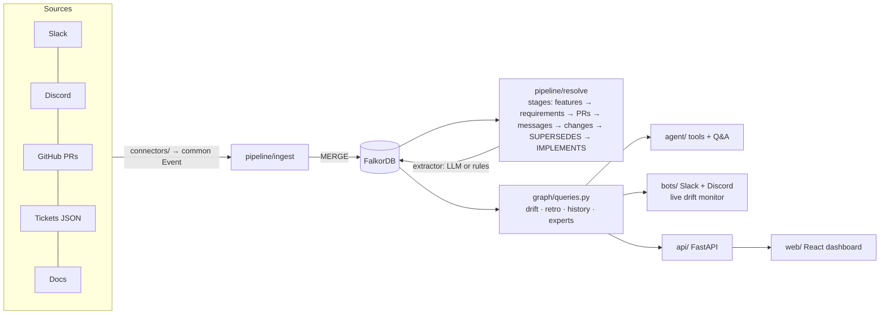
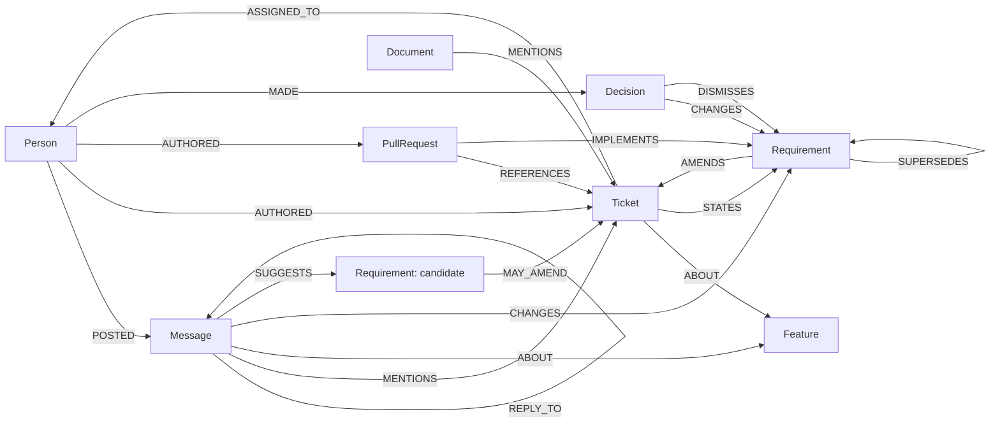

# Details: architecture, setup, tests

The [README](../README.md) is the short version. This page has the reference material.

## What one alert means

The graph path is the evidence:

```
(Person maya)-[:POSTED]->(Message @ slack#support-escalations, 2026-09-22)
   -[:CHANGES]->(Requirement "export supports any range up to 12 months + custom fields")
   -[:AMENDS]->(Ticket BD-101)-[:ABOUT]->(Feature "Ticket CSV export")
(PullRequest #6)-[:REFERENCES]->(Ticket BD-101), merged after the decision but IMPLEMENTS the older "last 30 days as CSV"
→ BD-101 still says "last 30 days"; PR #6 shipped the old scope; the export PRD is stale.
```

## Architecture



| Folder | What's in it |
|---|---|
| [`connectors/`](../connectors/) | Slack, Discord, GitHub, mock-ticket and docs connectors, plus a scenario replay. All emit one `Event` format |
| [`pipeline/`](../pipeline/) | `ingest`, `extract` (LLM / rules / oracle), `resolve` (one function per stage), `human` (actions that survive rebuilds), `live`, `webhooks` |
| [`graph/`](../graph/) | Connection, idempotent batched writers, [`queries.py`](../graph/queries.py) with every Cypher query ([reference](QUERIES.md)) |
| [`agent/`](../agent/) | Graph tools, LLM agent and rules agent, retro, spec generator |
| [`bots/`](../bots/) | Slack (Socket Mode) and Discord bots, daily digest |
| [`api/`](../api/), [`web/`](../web/) | FastAPI backend and React + TypeScript dashboard |
| [`benchmark/`](../benchmark/) | Every measurement in [`docs/RESULTS.md`](RESULTS.md), including the SQL baseline |
| [`config.py`](../config.py) | Every tuning constant, with the reason for its value |

<details>
<summary>Graph data model, resolution and extractors</summary>



- **Idempotent writes.** Every node is MERGEd on `id`.
- **Integer times.** Times are epoch-ms integers.
- **One node per ticket version.** Each ticket version is its own `Requirement`.
- **Explainable links.** Every resolution edge records `via`.
- **Human actions** carry `origin: 'human'`. Only extractor-made decisions are deleted on rebuild.

**Requirement changes** come from messages by someone with **decision rights** (the ticket's creator or assignee), at confidence ≥ `MIN_CONFIDENCE`. **The LLM extractor** returns structured output with an `evidence_quote`, which must appear literally in the message or the extraction is discarded.

**Extractors** (`--extractor`):
- `auto`: `llm` if the LLM answers, otherwise `heuristic`.
- `llm` (alias `deepseek`): any OpenAI-compatible model.
- `heuristic`: the rules.
- `oracle`: the answer key; a test harness only.

</details>

## The synthetic company

**Brightdesk** ([`data/scenario/company.md`](../data/scenario/company.md)) is a helpdesk SaaS with 8 people, 2 sprints, 300 messages, 15 tickets, 12 PRs and 4 docs.
- **Two drifts:** the CSV export (Slack) and the SLA notifications (Discord).
- **One clean control:** dark mode.
- **Traps:**
  - a change copied into its ticket;
  - a rejected XLSX proposal;
  - a "keep it as is" reaffirmation;
  - a PR with no ticket reference;
  - a decision on Discord about work tracked elsewhere.

[`answer_key.json`](../data/scenario/answer_key.json) records every expected link, change and drift.

## Setup

Requires Python 3.11+, Docker (local FalkorDB) or FalkorDB Cloud, and Node 18+ for the dashboard.

```bash
python -m venv .venv
.venv\Scripts\activate             # macOS/Linux: source .venv/bin/activate
pip install -r requirements.txt
cp .env.example .env               # every service is optional except FalkorDB
docker run -d --name falkordb-brain -p 6379:6379 -p 3001:3000 falkordb/falkordb:v4.22.1
python -m scripts.check_setup      # PASS/FAIL per service; for Slack it names any missing scope

python -m pipeline.build           # ingest + extraction + resolution, prints drift
cd web && npm install && npm run build && cd ..
uvicorn api.main:app --port 8000   # dashboard + API on http://localhost:8000
python -m scripts.demo_reset       # put the demo back in its starting state (see scripts/demo_script.md)
```

**The LLM is optional, and it can be local.** Any OpenAI-compatible endpoint works. For a free, offline, reproducible run with [Ollama](https://ollama.com), set these in `.env`:

```bash
ollama pull qwen3:8b
LLM_BASE_URL=http://localhost:11434/v1
LLM_MODEL=qwen3:8b
LLM_API_KEY=ollama
LLM_REASONING_EFFORT=none   # skip qwen3's thinking phase, about 15x faster
```

The strong-model numbers used Groq's free tier:

```bash
LLM_BASE_URL=https://api.groq.com/openai/v1
LLM_MODEL=openai/gpt-oss-120b
LLM_API_KEY=gsk_...
LLM_REASONING_EFFORT=low
LLM_MAX_RETRIES=10          # the free tier allows 8,000 tokens a minute
```

Unset, it uses DeepSeek (`DEEPSEEK_*`). Every extraction call is cached by (model, prompt) in `data/llm_cache/`, which is committed, so the qwen3 and gpt-oss **extraction** numbers (resolution, noise, real data) reproduce without a GPU or key. The **Q&A** numbers don't: the agent's calls aren't cached, so re-running them needs the model (Ollama or a key). When no LLM answers, everything falls back instead of failing.

**Real Slack, Discord and GitHub:** see [`docs/REAL_RUN.md`](REAL_RUN.md). `build --live` reads each configured source from its API, falls back to the scenario files for the rest, and prints which is which.

## Deploy (Docker / Render)

One image runs FalkorDB v4.22.1, the API and the built dashboard ([`Dockerfile`](../Dockerfile)); the graph is rebuilt from the synthetic company on every start.

```bash
docker build -t drift-monitor . && docker run -p 8000:8000 drift-monitor   # http://localhost:8000
```

On Render: New → Blueprint → this repo ([`render.yaml`](../render.yaml)). It runs as a public sandbox: without `INGEST_TOKEN`, visitors can resolve drifts, and a restart resets the demo. Set `INGEST_TOKEN` to require a token (the dashboard sends it from a `?token=` link).

## Tests and CI

`python -m pytest -q` runs 121 tests, none of which need an LLM or API keys. They include:
- the published numbers in [`docs/RESULTS.md`](RESULTS.md) against the committed result files ([`tests/test_readme_numbers.py`](../tests/test_readme_numbers.py));
- the fix-it agent: the plan's assignees, owners-only approval, follow-ups that survive a rebuild, the chat-thread commands, read-only tools and the post-generation id check ([`tests/test_work.py`](../tests/test_work.py));
- human actions surviving rebuilds, and live updates (a write-back survives a live recompute; an unverified candidate never supersedes the owner's decision);
- auth on every endpoint that changes the graph, GitHub webhook signatures and replayed deliveries, and per-org event isolation;
- router paraphrases outside the benchmark: unknown ids, loose PR ids, ticket-scoped answers;
- the IMPLEMENTS fallback;
- one stale-PR rule everywhere: for BD-103 / PR #5 and BD-101 / PR #6, the card's count, the PR label, the evidence path and the Q&A answer agree ([`tests/test_stale_pr_consistency.py`](../tests/test_stale_pr_consistency.py));
- unverified candidates;
- routing per intent and the former misroutes;
- the SQL baseline and the ablation guard;
- the graph, API, webhooks, connector contracts and paging.

[`.github/workflows/ci.yml`](../.github/workflows/ci.yml) also runs:
- ruff (lint and format) and mypy on `pipeline/` and `graph/`;
- the ablation, which fails on regression;
- the query-plan index check and a small stress test;
- the `docs/QUERIES.md` check and the React build.

FalkorDB is pinned to `v4.22.1`.

The full change history since the first submission draft is in [`docs/RESULTS.md`](RESULTS.md#what-changed-since-the-first-submission-draft).
