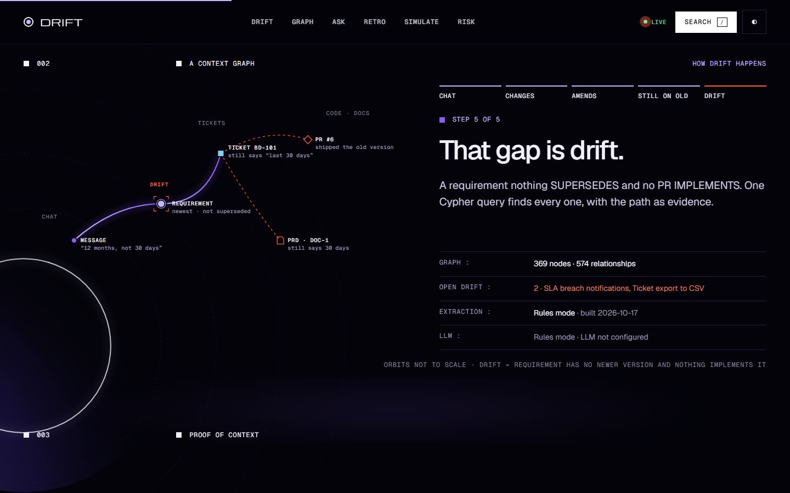
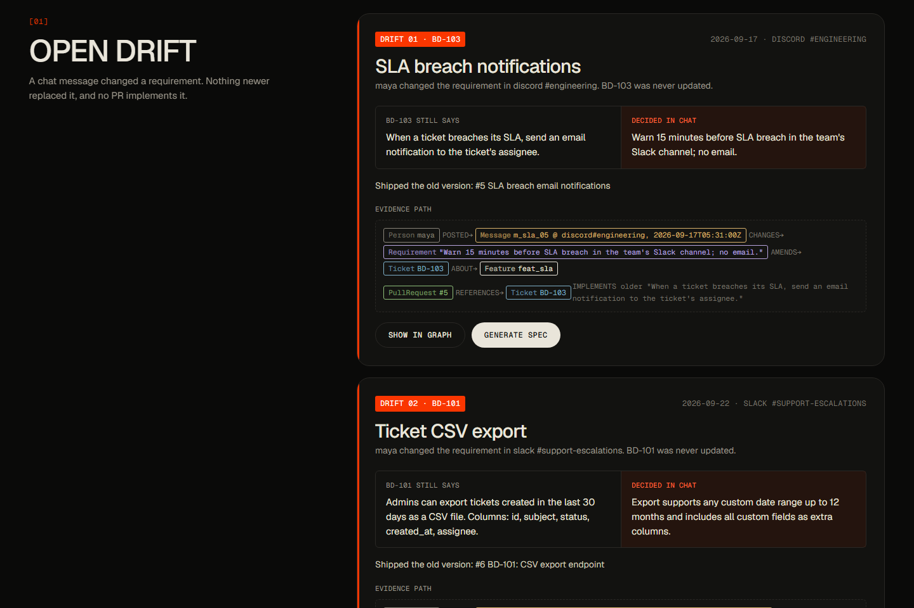
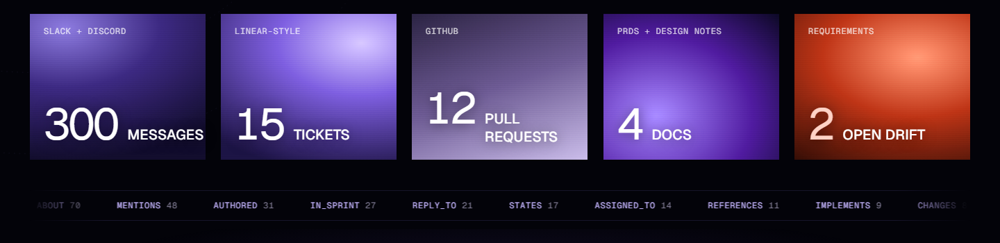

# Extras

These parts are built and tested, but they aren't what the project is about. The README covers the core: the context graph, drift, and how well both hold up.

## More features

- **Spec generation.** Turns a drifted feature's graph context into an agent-ready spec. Nothing executes it.
- **Coverage and risk.** PRs with no ticket, tickets closed with no code, tickets nobody discussed, and features where one person holds most of the knowledge ("bus factor 1").
- **Feature timeline.** Ticket versions, chat changes and PRs on one time axis. The stretch where the ticket and PRs never caught up is shaded.
- **Close the loop.** Each drift card has two actions, both written to the graph so they stay auditable:
  - **Write to ticket** makes the decided requirement the ticket's next version (`Ticket -STATES-> new version -SUPERSEDES-> chat requirement`).
  - **Keep old scope** records `Person -MADE-> Decision {kind: dismissal} -DISMISSES-> requirement`.
- **Browse the brain.** `/` or Ctrl+K searches through FalkorDB full-text indexes. Person profiles show what someone owns, shipped and decided. Double-click a node to expand its neighbours.

| How drift happens | Open drift with evidence paths | What's in the graph |
|---|---|---|
|  |  |  |

## Dashboard

React 18 + TypeScript, built with Vite. Motion uses Framer Motion: split-text hero, scroll reveals, the orbit diagram drawing in, count-ups and drift-card exit animations. The graph view uses Cytoscape.js. State lives in one small context ([`web/src/lib/brain.tsx`](../web/src/lib/brain.tsx)), and every API shape is typed in [`web/src/lib/api.ts`](../web/src/lib/api.ts).

URL options:
- `?theme=light|dark`
- `?view=timeline`
- `?person=sofia`
- `?q=breach`
- `?static`: no entrance animations and no live stream, for screenshots and projectors.

For frontend development, run `npm run dev` in `web/`. Vite serves on :5173 and proxies `/api` to `API_URL`, default `http://localhost:8010`.

**3D hero.** [`web/src/components/Planet3D.tsx`](../web/src/components/Planet3D.tsx) uses three.js through React Three Fiber, with custom GLSL shaders and no external models. It shows a procedurally shaded planet with a fresnel atmosphere. The context graph orbits it: message, ticket, requirement, PR and doc nodes sit on tilted orbits, with a red drift link pulsing between a message and the ticket it never reached. The scene:
- is lazy-loaded and pauses when off-screen;
- follows the theme and respects reduced motion;
- falls back to a CSS planet without WebGL;
- sits behind an error boundary.

## Live updates (Server-Sent Events)

`GET /api/events` pushes `drift`, `resolved`, `ticket`, `pr` and `rebuild` events to every open dashboard, which shows a toast and refreshes.

[`api/bus.py`](../api/bus.py) delivers events locally and also publishes them on a Redis channel of the FalkorDB server, which speaks Redis. The API forwards events from other processes, so a drift the Slack or Discord bot detects appears live on every dashboard.

## Webhooks

| Endpoint | What it does |
|---|---|
| `POST /api/ingest/ticket` `{ticket, description, actor}` | Ticket-tracker webhook (Linear/Jira-style). Adds the new description as a `Requirement` version and recomputes that ticket's `SUPERSEDES` chain with the `reflects` check. An edit that carries the chat decision resolves the drift; a cosmetic edit ("typo fixed") doesn't. The response lists `resolved`, `still_drifting` and `new_drift`. |
| `POST /api/ingest/doc` `{doc, text, title?, actor}` | Docs webhook (Notion/Confluence-style). Updates the page and links any new ticket mentions. A doc edited after the decision is no longer reported as stale. |
| `POST /api/ingest/github` | GitHub `pull_request` webhook. Verifies `X-Hub-Signature-256` when `GITHUB_WEBHOOK_SECRET` is set, links the PR to the tickets it names, decides which requirement version it `IMPLEMENTS`, and re-checks drift. |

The dashboard's **Simulate the team** section drives both the chat path and the ticket webhook.

## API hardening and observability

- **Write token.** Optional `INGEST_TOKEN` protects the write endpoints, using a constant-time compare.
- **CORS** is opt-in (`CORS_ORIGINS`).
- **Caching.** Heavy reads are cached with a short TTL. The cache is invalidated whenever the API writes, because each write bumps the event-bus version.
- **Timing.** Every response carries a `Server-Timing` header, and slow requests are logged.
- **Prometheus metrics.** `GET /api/metrics` serves request counts and latency histograms per route, cache hits and misses, SSE subscribers, the event-bus version and open drift per org.
- **Rate limiting.** The expensive POSTs (`/api/ask`, `/api/simulate`, `/api/spec`) are rate-limited per client with a token bucket (`RATE_LIMIT_PER_MIN`, default 30). Over the limit they return `429` with `Retry-After`.
- **OpenAPI docs** are at `/docs`.

## Multi-tenancy

Each organisation gets its own isolated FalkorDB graph (`company_brain__<org>`). Each request picks its org with an `X-Org` header, or with `?org=` for EventSource, which can't send headers. The dashboard forwards `?org=acme` from its own URL.

Caches and live events are scoped per org, so one tenant never sees another's alerts. Org ids are validated (`[a-z0-9_-]`), so a header can't address an arbitrary graph. Two endpoints manage orgs:
- `POST /api/orgs/{org}/bootstrap` seeds a new org with the demo data.
- `GET /api/orgs` lists the orgs.

## Daily digest

Posts open drift with graph paths, plus coverage risks. Run it from cron or any scheduler:

```bash
python -m bots.digest --dry-run              # print it
python -m bots.digest --slack C0123456789    # post to Slack
python -m bots.digest --discord 1234567890   # post to Discord (REST, no gateway connection)
```
